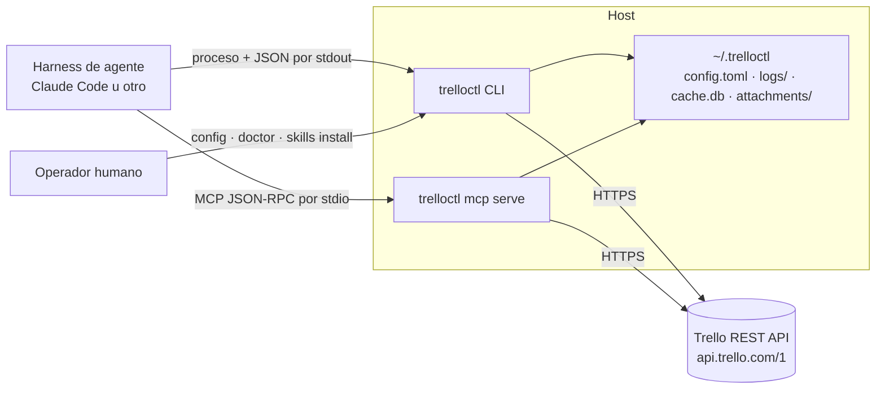
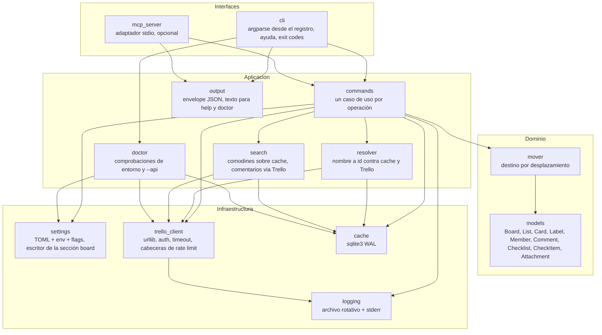
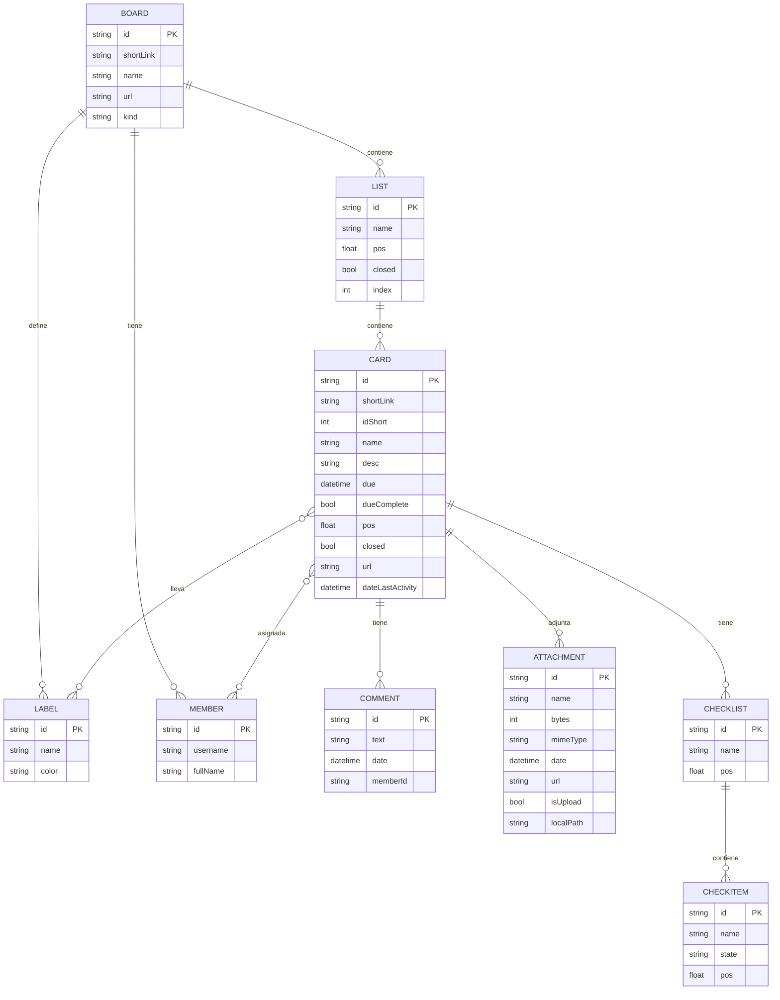
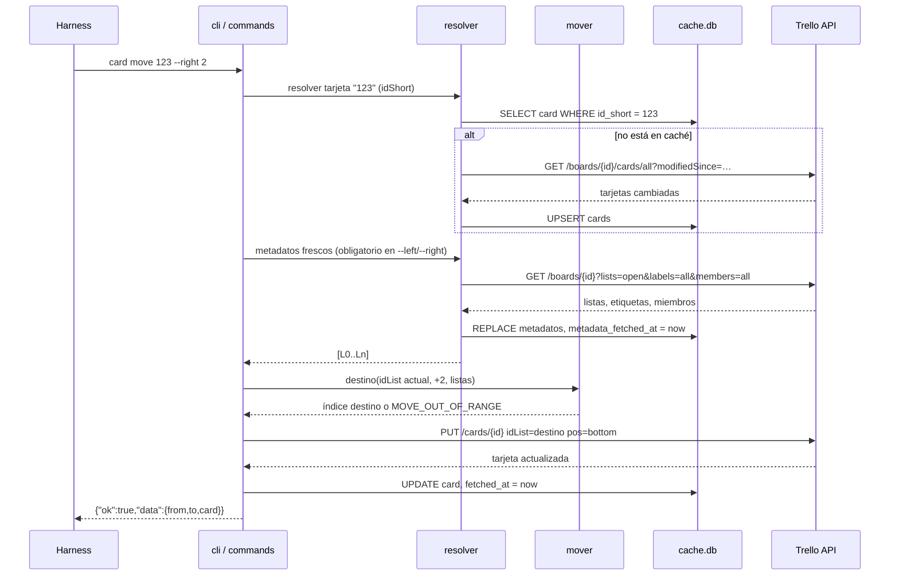
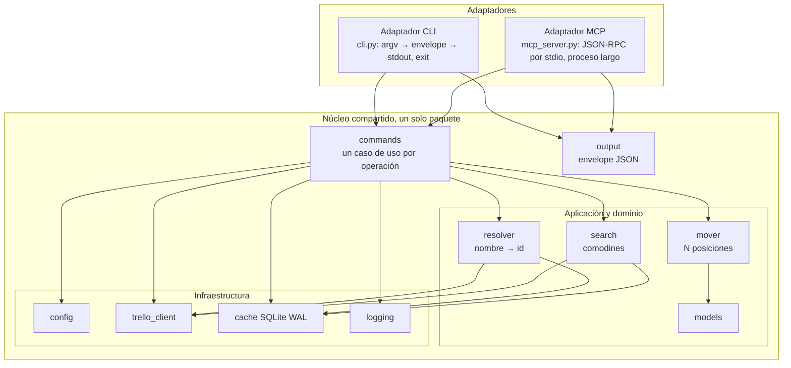
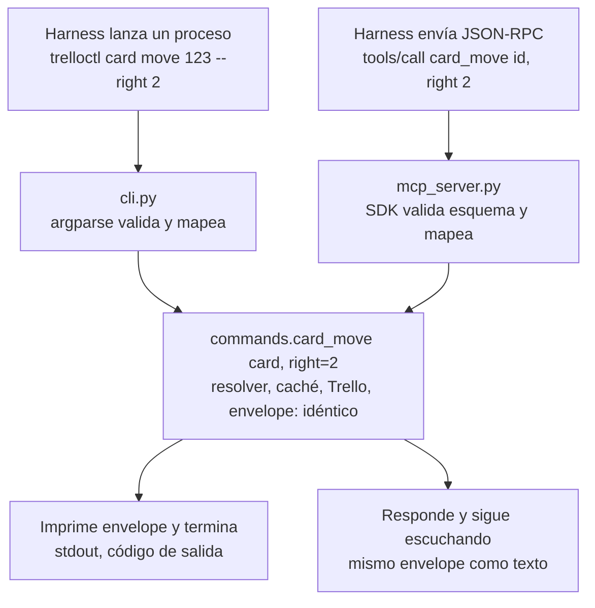

# trelloctl — Product Requirements Document

## 1. Metadatos

| Campo       | Valor                                                    |
| ----------- | -------------------------------------------------------- |
| Autor       | Ariel Salazar Hinojosa                                   |
| Estado      | Aprobado                                                 |
| Versión     | 1.1.0 (historial en §13)                                 |
| Fecha       | 2026-11-09                                               |
| Revisores   | Ariel Salazar Hinojosa                                   |
| Repositorio | `trelloctl`                                              |
| Alcance     | PRD + arquitectura. Sin planificación ni plan de pruebas |

## 2. Resumen

Los harness de agentes (Claude Code y similares) no tienen una forma fiable de operar un tablero de Trello: el API REST exige autenticación, resolución de identificadores y manejo de errores que un agente repite mal en cada invocación. `trelloctl` es una herramienta de línea de comandos que encapsula esas operaciones sobre un tablero (el configurado por defecto o el indicado en cada comando), devuelve siempre JSON estructurado y expone, opcionalmente, las mismas operaciones como servidor MCP por stdio. El resultado esperado es que un agente pueda crear, consultar, mover y etiquetar tarjetas, gestionar listas y checklists, y asignar miembros con un solo comando por operación y sin lógica adicional.

## 3. Problema y contexto

- **Quién lo sufre.** Personas que delegan la gestión de un tablero Trello a un agente automatizado, y el propio agente.
- **Síntoma.** Cada automatización reimplementa llamadas HTTP, autenticación, búsqueda de listas por nombre y manejo de límites de tasa. Los errores se expresan como texto libre que el agente no puede interpretar de forma determinista.
- **Evidencia.** El API de Trello identifica listas, etiquetas y tarjetas por ids opacos; mover una tarjeta "una columna a la derecha" exige leer el tablero, ordenar listas por posición y calcular el destino. No existe un comando que lo haga.
- **Consecuencia.** Automatizaciones frágiles, acopladas a un tablero concreto y difíciles de auditar.

## 4. Objetivos y no objetivos

### Objetivos

1. Exponer las operaciones habituales sobre un tablero como comandos con salida JSON estable.
2. Permitir mover tarjetas y listas N posiciones a izquierda o derecha sin que el llamante conozca ids.
3. Centralizar configuración, logs y estado local en `~/.trelloctl`.
4. Funcionar en macOS y Windows con una sola base de código.
5. Minimizar dependencias en tiempo de ejecución.
6. Ser consumible por un harness: salida parseable, códigos de salida estables, errores tipados.

### No objetivos

- Interfaz gráfica o TUI.
- Operar varios tableros en una misma invocación. Cada comando actúa sobre un solo tablero; la única excepción es `inbox move` (RF‑28).
- Sincronización bidireccional o réplica local del tablero.
- Administración de usuarios, organizaciones, Power‑Ups o facturación de Trello.
- Reemplazar la interfaz web de Trello para uso humano.

## 5. Métricas de éxito

| Métrica                                                                 | Objetivo                    |
| ----------------------------------------------------------------------- | --------------------------- |
| Operaciones cubiertas por un único comando                              | 100 % de las listadas en §7 |
| Invocaciones que devuelven JSON válido (salvo las excepciones de AC‑3.1) | 100 %                       |
| Dependencias de runtime fuera de la biblioteca estándar                 | 0 en la instalación base    |
| Plataformas soportadas                                                  | macOS y Windows             |
| Tiempo de una operación simple (sin red lenta)                          | < 2 s de extremo a extremo  |

## 6. Usuarios y casos de uso

### Usuarios

- **Harness de agente.** Invoca comandos o herramientas MCP, parsea JSON, decide el siguiente paso. Usuario principal.
- **Operador humano.** Configura credenciales y el tablero por defecto, ejecuta `doctor`, instala el skill, revisa logs. Usuario secundario.

### Casos de uso

| Id    | Caso de uso                                                                  | Actor  |
| ----- | ---------------------------------------------------------------------------- | ------ |
| CU‑1  | Configurar credenciales y tablero por defecto                                | Humano |
| CU‑2  | Verificar que la máquina puede ejecutar la herramienta                       | Humano |
| CU‑3  | Listar listas, etiquetas, miembros y actividad del tablero                   | Agente |
| CU‑4  | Crear, renombrar, mover y archivar listas del tablero                        | Agente |
| CU‑5  | Crear, editar y borrar etiquetas del tablero                                 | Agente |
| CU‑6  | Crear y copiar tarjetas                                                      | Agente |
| CU‑7  | Consultar y buscar tarjetas por patrón                                       | Agente |
| CU‑8  | Mover una tarjeta a una lista concreta o N columnas a izquierda/derecha      | Agente |
| CU‑9  | Actualizar campos, completar y archivar una tarjeta                          | Agente |
| CU‑10 | Comentar, editar o borrar comentarios propios                                | Agente |
| CU‑11 | Etiquetar y asignar miembros a una tarjeta                                   | Agente |
| CU‑12 | Gestionar checklists y marcar sus ítems                                      | Agente |
| CU‑13 | Listar, descargar, subir y limpiar adjuntos                                  | Agente |
| CU‑14 | Recargar o inspeccionar el caché local                                       | Ambos  |
| CU‑15 | Exponer las operaciones anteriores como servidor MCP por stdio               | Agente |
| CU‑16 | Instalar el skill en el harness                                              | Humano |
| CU‑17 | Ver el Inbox personal, crear tarjetas en él y moverlas a una lista del tablero | Agente |

## 7. Requisitos funcionales

Prioridad: **M** must, **S** should, **C** could.

### RF‑1 Configuración (M)

Criterios de aceptación:

- AC‑1.1 El directorio de trabajo es `~/.trelloctl` (en Windows, `%USERPROFILE%\.trelloctl`). La variable de entorno `TRELLOCTL_HOME` lo sobrescribe.
- AC‑1.2 El archivo de configuración es `<HOME>/config.toml`, con el contenido de §10.5. Si no existe, cualquier comando que hable con Trello falla con `CONFIG_NOT_FOUND`. No lo necesitan `--help`, `--version`, `version`, `doctor`, `config init`, `config show` ni `skills *`. `config board set|unset` y `config validate` exigen el archivo (`CONFIG_NOT_FOUND` si falta); `config board set` con un nombre exige además credenciales (`AUTH_MISSING`).
- AC‑1.3 `config init` crea el directorio y un `config.toml` con la configuración mínima (solo `[auth]` activo, con `api_key` y `token` vacíos) seguida, comentadas, de todas las demás secciones y claves con su valor por defecto y su explicación; como una clave ausente toma su valor por defecto, la configuración efectiva es la misma que con la plantilla completa de §10.5. No sobrescribe uno existente salvo `--force`. Indica cómo obtener las credenciales: la API key en `https://trello.com/power-ups/admin` (Power‑Up → Trello Auth → "Generate a new API Key") y el token en `https://trello.com/1/authorize?expiration=never&scope=read,write&response_type=token&key=<key>`.
- AC‑1.4 Precedencia: flags > variables de entorno > `config.toml` > valores por defecto. Variables reconocidas: `TRELLOCTL_HOME`, `TRELLO_API_KEY`, `TRELLO_TOKEN`, `TRELLO_BOARD`.
- AC‑1.5 Sin `api_key` o `token` en archivo ni entorno, cualquier comando que hable con Trello falla con `AUTH_MISSING`. Si Trello rechaza las credenciales (401 con `invalid key` o `invalid token`, o 401 en `GET /members/me`), `AUTH_INVALID` sin reintento. Un 401 o 403 sobre un recurso concreto con credenciales válidas se traduce según AC‑23.3 (`API_ERROR`) o, si el recurso es un tablero, `BOARD_NOT_FOUND`.
- AC‑1.6 `config show` imprime la configuración efectiva en JSON con el token enmascarado. `config validate` valida tipos, campos obligatorios y acceso al tablero por defecto, si lo hay, y reporta cada problema con su clave TOML.
- AC‑1.7 Un archivo TOML malformado produce `CONFIG_INVALID` con línea y columna cuando el parser las proporciona.
- AC‑1.8 `config.toml` guarda un único tablero por defecto en `[board].default` (id o shortLink). Cada invocación opera sobre un solo tablero: el de `--board`, si no el de `TRELLO_BOARD`, si no el por defecto; sin ninguno de los tres, `BOARD_NOT_CONFIGURED`. Una excepción: un comando `card` que recibe la tarjeta por id (24 hexadecimales) o URL de Trello la localiza sin tablero seleccionado, y el contexto (listas, etiquetas, miembros y caché) es el tablero de la tarjeta (AC‑22.9 y AC‑28.7).
- AC‑1.9 `--board` y `TRELLO_BOARD` aceptan id (24 hexadecimales), shortLink (8 alfanuméricos), URL de Trello (`https://trello.com/b/<shortLink>/...`) o nombre, resueltos así: un id de 24 hexadecimales y una URL se resuelven directamente; un valor de 8 alfanuméricos se busca primero por nombre y, si ninguno coincide, como shortLink, ambos contra la lista de tableros del usuario (`GET /members/me/boards`) cacheada con el TTL de metadatos y sin llamadas extra; cualquier otro valor se trata como nombre. La recarga y el reintento de AC‑22.12 aplican a ambos. Si un nombre coincide con varios tableros, `AMBIGUOUS_BOARD`. Por defecto la resolución por nombre solo considera los tableros activos (no archivados en Trello), estén o no en `config.toml`; la opción global `--include-archived-boards` (en MCP, el parámetro opcional `include_archived_boards`) incluye también los archivados y, con ella, un nombre repetido entre un tablero activo y uno archivado da `AMBIGUOUS_BOARD`. Por id, shortLink o URL un tablero archivado se alcanza siempre.
- AC‑1.10 `config board show` muestra el tablero por defecto (id, nombre, url) o indica que no hay. `config board set <tablero>` resuelve `<tablero>` según AC‑1.9 y guarda su id; `config board unset` lo elimina. El escritor reescribe solo la sección `[board]`, conserva el resto del archivo línea a línea y deja una copia `config.toml.bak` antes de escribir.
- AC‑1.11 `logging.level` fija el nivel por defecto de RF‑24. `http.*` parametriza RF‑23. `cache.*` fija los TTL de RF‑22; el caché no se puede desactivar por configuración, solo por invocación con `--no-cache`.
- AC‑1.12 Todas las claves salvo `[auth]` son opcionales: una clave ausente toma el valor por defecto de la plantilla de §10.5. Un `config.toml` con solo `[auth]` es válido (configuración mínima en §10.5).

### RF‑2 Directorio de trabajo (M)

Criterios de aceptación:

- AC‑2.1 El directorio contiene `config.toml`, `logs/`, `cache.db` y `attachments/` (ver §10.6).
- AC‑2.2 La herramienta crea los subdirectorios que falten en el primer uso. Solo borra archivos que ella misma generó (caché y adjuntos descargados) y solo cuando se le pide.
- AC‑2.3 Si el directorio no existe y no puede crearse, o no es escribible, `HOME_NOT_WRITABLE`.
- AC‑2.4 En sistemas POSIX, `config.toml` se crea con permisos `0600`. En Windows se hereda la ACL del perfil de usuario.

### RF‑3 Salida JSON (M)

Criterios de aceptación:

- AC‑3.1 Toda invocación escribe en stdout un único objeto JSON con la forma de §10.5, salvo `--help`/`-h`, `--version`, la invocación sin argumentos y `doctor` sin `--json`, que escriben texto.
- AC‑3.2 Los logs y diagnósticos nunca se escriben en stdout; van a stderr y al archivo de log.
- AC‑3.3 La salida va indentada con dos espacios, en UTF‑8 sin escapar caracteres no ASCII y con salto de línea final. El flag global `--compact` la escribe en una sola línea. No existe clave de configuración ni variable de entorno para el formato; el servidor MCP siempre responde compacto.
- AC‑3.4 Los errores también se devuelven como JSON, con `ok: false`, un `code` del catálogo de §10.5 y un código de salida distinto de cero.

### RF‑4 Ayuda (M)

Criterios de aceptación:

- AC‑4.1 `--help` y `-h` imprimen ayuda legible por humanos con código de salida 0, en cualquier nivel: general, grupo o comando. Cada comando describe argumentos, opciones y un ejemplo.
- AC‑4.2 Invocar sin argumentos imprime la ayuda general y devuelve código de salida 2.
- AC‑4.3 La ayuda general documenta los TTL del caché, la regla de selección de tablero y qué comandos exigen `--yes` (ejemplo en §10.5).

### RF‑5 Diagnóstico `doctor` (M)

Criterios de aceptación:

- AC‑5.1 `doctor` imprime un informe legible por humanos; `doctor --json` devuelve el mismo informe en JSON.
- AC‑5.2 Comprueba, en orden: versión del intérprete; existencia, permisos y escritura en el directorio de trabajo, `logs/` y `attachments/`; parseo de `config.toml`; presencia de credenciales; resolución DNS y conectividad TLS con el host de `http.base_url` (por defecto `api.trello.com`; si `base_url` no es HTTPS, la comprobación TLS es `WARN` «not applicable», y el mensaje de fallo TLS incluye siempre la sugerencia sobre los certificados de macOS); validez del token; acceso al tablero por defecto, si lo hay; integridad (`PRAGMA integrity_check`) y versión de esquema de `cache.db`; extra MCP instalado (paquete `mcp` localizable con `importlib.util.find_spec`) y su versión; versión del skill instalado en el harness (ámbitos `user` y `project`) frente a la empaquetada; disponibilidad del Inbox (AC‑28.5).
- AC‑5.3 Cada comprobación muestra `OK`, `WARN` o `FAIL` con una línea de explicación y, en caso de fallo, la acción sugerida.
- AC‑5.4 Código de salida 0 si no hay `FAIL`, 1 si hay alguno.
- AC‑5.5 `doctor --api` descarga la especificación OpenAPI que publica Trello (`swagger.v3.json` en `developer.atlassian.com/cloud/trello/`, verificada el 2026-11-09) y comprueba que cada endpoint, método y parámetro que usa la herramienta sigue existiendo: `WARN` para parámetros marcados obsoletos, `FAIL` para endpoints ausentes. Si la especificación no está disponible lo reporta como `WARN`. Después ejecuta una lectura de humo por cada endpoint de lectura contra el tablero por defecto.
- AC‑5.6 `doctor` no deja rastro: crea los subdirectorios que falten y elimina cualquier archivo temporal de las pruebas de escritura.

### RF‑6 Versión (M)

Criterios de aceptación:

- AC‑6.1 `--version` imprime la versión en una línea de texto; `version` la devuelve en JSON junto con la versión del intérprete y la plataforma.

### RF‑7 Resolución de identificadores (M)

Donde un comando espera una entidad, acepta su id o un identificador humano. Los nombres se resuelven contra el caché (RF‑22) sin distinción de mayúsculas. El API de Trello solo acepta ids: la única resolución unívoca garantizada es por id.

Criterios de aceptación:

- AC‑7.1 Tablero: id, shortLink, URL o nombre (AC‑1.9).
- AC‑7.2 Lista: id o nombre. Etiqueta: id, nombre o `nombre:color`. Miembro: id o username. Checklist: id o nombre dentro de la tarjeta. Ítem: id o nombre dentro del checklist. Comentario: solo id (el `idAction` de Trello).
- AC‑7.3 Tarjeta: id (24 hexadecimales), shortLink (8 alfanuméricos), URL de Trello, número corto (`idShort`, valor compuesto solo por dígitos) o nombre. Un valor solo de dígitos se interpreta siempre como `idShort`; una tarjeta con nombre numérico se localiza con `card search`. Un valor de 8 alfanuméricos se busca primero por nombre y, si no hay coincidencia, por shortLink, ambos contra el caché de tarjetas y sin llamadas extra; la recarga y el reintento de AC‑22.12 aplican a ambos, y un id de 24 hexadecimales o una URL no cambian. Un id o una URL se localizan sin tablero seleccionado (AC‑1.8); un shortLink suelto, un `idShort` y un nombre exigen tablero seleccionado, porque se buscan en su caché.
- AC‑7.4 Si un nombre coincide con varias entidades se devuelve `AMBIGUOUS_<ENTIDAD>` con los candidatos (id, nombre y contexto: lista para tarjetas, color para etiquetas) en `details.candidates`, y no se ejecuta la operación.
- AC‑7.5 Un identificador no resuelto produce `<ENTIDAD>_NOT_FOUND` con el valor recibido, tras el reintento de AC‑22.12.

### RF‑8 Lectura del tablero (M)

Criterios de aceptación:

- AC‑8.1 `board show` devuelve id, shortLink, nombre, url, si es el tablero por defecto, y recuento de listas, tarjetas y etiquetas.
- AC‑8.2 `board lists` devuelve las listas abiertas ordenadas por posición, con índice 0‑based, id, nombre y número de tarjetas. `--all` incluye las archivadas con su marca `closed`.
- AC‑8.3 `board labels` devuelve id, nombre y color. `board members` devuelve id, username y nombre completo.
- AC‑8.4 Las cuatro lecturas se sirven del caché (RF‑22): metadatos para listas, etiquetas y miembros; el snapshot de tarjetas, con su TTL, para los recuentos de tarjetas.

### RF‑9 Listas del tablero (M)

Criterios de aceptación:

- AC‑9.1 `board list create --name <texto> [--pos top|bottom|<índice>]` crea una lista (`POST /lists`), por defecto al final. `<índice>` es la posición 0‑based entre las listas abiertas.
- AC‑9.2 `board list rename <lista> --name <texto>` renombra (`PUT /lists/{id}`).
- AC‑9.3 `board list archive <lista>` archiva y `board list unarchive <lista>` restaura (`PUT /lists/{id}/closed`). Archivar una lista no archiva sus tarjetas; Trello las oculta con ella. No existe borrado de listas por API.
- AC‑9.4 `board list move <lista> --to-index N | --left N | --right N` cambia la posición de la lista entre las abiertas, con la semántica de AC‑14.2 a AC‑14.5, incluida la lectura fresca de metadatos.
- AC‑9.5 `board list move-cards <lista> --to <lista>` mueve todas las tarjetas abiertas de una lista a otra (`POST /lists/{id}/moveAllCards`) y devuelve cuántas movió. `board list archive-cards <lista>` archiva todas las tarjetas abiertas de la lista (`POST /lists/{id}/archiveAllCards`); es reversible tarjeta a tarjeta con `card unarchive`. Ambas marcan rancio el snapshot de tarjetas (AC‑22.7).

### RF‑10 Etiquetas del tablero (S)

Criterios de aceptación:

- AC‑10.1 `board label create --name <texto> --color <color>` crea una etiqueta (`POST /labels`). Colores válidos: `green`, `yellow`, `orange`, `red`, `purple`, `blue`, `sky`, `lime`, `pink`, `black`, sus variantes `_light` y `_dark`, y `none`; otro valor es error de uso.
- AC‑10.2 `board label update <etiqueta> [--name <texto>] [--color <color>]` modifica solo los campos indicados (`PUT /labels/{id}`).
- AC‑10.3 `board label remove <etiqueta> --yes` borra la etiqueta del tablero y de todas sus tarjetas (`DELETE /labels/{id}`), la quita de `cards.id_labels` en el caché y devuelve cuántas tarjetas la tenían.

### RF‑11 Actividad del tablero (S)

Criterios de aceptación:

- AC‑11.1 `board activity [--since <ISO‑8601>] [--before <ISO‑8601>] [--type <a,b,c>] [--limit N]` devuelve las acciones del tablero (`GET /boards/{id}/actions`), más recientes primero, con el límite de AC‑13.4 y paginando con `before` cuando hace falta.
- AC‑11.2 Cada acción se normaliza a: id, tipo, fecha, miembro (id y username), tarjeta (id y nombre, si aplica), lista (id y nombre, si aplica) y un resumen de `data` específico del tipo.
- AC‑11.3 `--type` acepta los tipos de acción de Trello (`createCard`, `updateCard`, `commentCard`, `addMemberToCard`, `updateList`, etc.); un tipo desconocido es error de uso.
- AC‑11.4 La actividad no se cachea.

### RF‑12 Crear tarjeta (M)

Criterios de aceptación:

- AC‑12.1 `card create --list <lista> --name <texto>` crea la tarjeta al final de la lista y devuelve la tarjeta completa.
- AC‑12.2 Opciones: `--desc`, `--due <ISO‑8601>`, `--labels <a,b,c>`, `--members <u1,u2>`, `--pos top|bottom|<índice>` (posición 0‑based dentro de la lista).
- AC‑12.3 La descripción se envía tal cual; Trello la interpreta como Markdown y muestra el HTML literal. Máximo 16 384 caracteres; si se supera, error de uso sin llamar al API. Aplica también a `card update --desc`.
- AC‑12.4 `--desc <texto>`, `--desc-file <ruta>` y `--desc -` (stdin hasta EOF, UTF‑8) son excluyentes. Lo mismo rige para `--text`, `--text-file` y `--text -` en comentarios y para `--items`, `--items-file` en checklists.
- AC‑12.5 Si alguna etiqueta o miembro no resuelve, no se crea la tarjeta y se devuelve el error correspondiente.

### RF‑13 Consultar y buscar tarjetas (M)

Criterios de aceptación:

- AC‑13.1 `card get <tarjeta>` devuelve la tarjeta con lista, etiquetas, miembros, due, `dueComplete`, url, fecha de última actividad y los contadores de `badges`. `--full` añade checklists con sus ítems, adjuntos y comentarios; `--with comments,checklists,attachments` elige un subconjunto. Checklists y adjuntos salen del caché; los comentarios cuestan una llamada.
- AC‑13.2 `card list [--list <lista>] [--label <etiqueta>] [--member <m>] [--due-before <ISO‑8601>] [--due-after <ISO‑8601>] [--done | --not-done]` devuelve las tarjetas abiertas que cumplen todos los filtros, desde el caché; sin filtros, todas las del tablero.
- AC‑13.3 `card search <patrón> [--in name,desc,checklists,comments]` busca tarjetas; por defecto en `name` y `desc`. El patrón admite `*` (cualquier secuencia), `?` (un carácter) y las clases `[...]` de GLOB, sin distinción de mayúsculas; sin comodines equivale a `*patrón*`. `name`, `desc` y `checklists` se resuelven en el caché con `lower(campo) GLOB lower(patrón)` sin llamadas, incluidas las clases `[...]`. `comments` se delega a `GET /search` de Trello con el operador `comment:` restringido al tablero y `partial=true`: una llamada, búsqueda por palabra; los caracteres `*`, `?`, `[` y `]` se eliminan del patrón antes de enviarlo, porque el API no los admite, y `meta.warnings` lo indica. Cada resultado indica en qué campos coincidió (`matched`) y, para comentarios, el id del comentario.
- AC‑13.4 `card list`, `card search`, `card comments`, `board activity` e `inbox list` devuelven como máximo 50 elementos por defecto; `--limit N` lo cambia y `--limit 0` lo elimina (paginando contra Trello donde aplique). `meta.truncated = true` indica que quedaron resultados fuera. `--fields a,b,c` acota los campos de cada elemento en esos mismos listados. El resto de listados (listas, etiquetas, miembros, checklists, adjuntos) devuelve siempre el conjunto completo.
- AC‑13.5 `card list` y `card search` excluyen las tarjetas archivadas; `--include-archived` las incluye con su marca `archived`, recargando antes el snapshot de archivadas si no existe o venció (AC‑22.6).
- AC‑13.6 Toda lectura servida desde el caché acepta `--fresh`, que ignora el TTL en esa invocación, lee de Trello y actualiza el caché.

### RF‑14 Mover tarjeta (M)

Criterios de aceptación:

- AC‑14.1 `card move <tarjeta> --to <lista> [--pos top|bottom|<índice>]` mueve la tarjeta a la lista indicada, al final por defecto.
- AC‑14.2 `card move <tarjeta> --right N` mueve la tarjeta a la lista situada N posiciones a la derecha de la actual en el orden de las listas abiertas; `--left N` es el equivalente hacia la izquierda. N es un entero ≥ 1, por defecto 1. Las listas archivadas no cuentan. La tarjeta se coloca al final de la lista destino salvo `--pos top|bottom|<índice>`. Antes de calcular se leen los metadatos frescos (AC‑22.11).
- AC‑14.3 Si el destino queda fuera del rango, `MOVE_OUT_OF_RANGE` con el índice actual, el calculado y el número de listas, sin modificar nada. Con `--clamp` se mueve a la primera o última lista.
- AC‑14.4 `--to`, `--left`, `--right` (y `--to-index` en listas) son mutuamente excluyentes; combinarlos es error de uso.
- AC‑14.5 `--dry-run` calcula y devuelve el resultado sin llamar al API de escritura. La respuesta incluye origen, destino y sus índices.

### RF‑15 Copiar tarjeta (S)

Criterios de aceptación:

- AC‑15.1 `card copy <tarjeta> --to <lista> [--name <texto>] [--pos top|bottom|<índice>]` crea una copia (`POST /cards` con `idCardSource`); sin `--name` conserva el nombre.
- AC‑15.2 `--keep all|none|<lista separada por comas>` controla qué se copia: `attachments`, `checklists`, `comments`, `due`, `labels`, `members`, `stickers`. Por defecto `all`.
- AC‑15.3 La respuesta devuelve la tarjeta nueva completa y la inserta en el caché.

### RF‑16 Actualizar, completar y archivar (M)

Criterios de aceptación:

- AC‑16.1 `card update <tarjeta>` acepta `--name`, `--desc`, `--desc-file`, `--desc -`, `--due`, `--no-due`, `--done | --not-done`, `--labels`, `--members`, `--pos`; solo modifica los campos indicados.
- AC‑16.2 `card done <tarjeta>` marca la tarjeta como completada (`dueComplete = true`) y `card undone <tarjeta>` lo revierte. Equivale a "Marcar como completada" en la web y no exige fecha límite.
- AC‑16.3 `card archive <tarjeta>` archiva; `card unarchive <tarjeta>` restaura.
- AC‑16.4 No existe borrado permanente de tarjetas. Las operaciones irreversibles que sí existen (`board label remove`, `card comment remove`, `card checklist remove`, `card checklist item remove`) exigen `--yes`; sin él devuelven `CONFIRMATION_REQUIRED` y no modifican nada.

### RF‑17 Comentarios (M; editar y borrar, C)

Los comentarios no se cachean; el recuento sí (`badges.comments`).

Criterios de aceptación:

- AC‑17.1 `card comments <tarjeta>` devuelve los comentarios con id, autor, fecha y texto, con el límite de AC‑13.4.
- AC‑17.2 `card comment add <tarjeta> --text <texto> | --text-file <ruta> | --text -` añade un comentario y devuelve su id. El texto admite menciones `@username`, que Trello notifica.
- AC‑17.3 `card comment edit <tarjeta> <comentario> --text ...` reemplaza el texto (`PUT /cards/{id}/actions/{idAction}/comments`). `card comment remove <tarjeta> <comentario> --yes` lo borra. Ambas solo sobre comentarios creados con el token configurado; sobre uno ajeno Trello responde error y se devuelve `API_ERROR`.
- AC‑17.4 Tras añadir, editar o borrar se actualiza `badges.comments` en el caché.

### RF‑18 Etiquetas de tarjeta (M)

Criterios de aceptación:

- AC‑18.1 `card label add <tarjeta> <etiqueta>[,…]` añade; las ya presentes se ignoran. `card label remove <tarjeta> <etiqueta>[,…]` quita; las ausentes se ignoran. `card label set <tarjeta> <etiqueta>[,…]` deja exactamente ese conjunto y equivale a `card update --labels`.
- AC‑18.2 La respuesta devuelve el conjunto final de etiquetas de la tarjeta.

### RF‑19 Miembros de tarjeta (M)

Criterios de aceptación:

- AC‑19.1 `card member add <tarjeta> <miembro>[,…]` asigna (`POST /cards/{id}/idMembers`); los ya asignados se ignoran. `card member remove <tarjeta> <miembro>[,…]` desasigna (`DELETE /cards/{id}/idMembers/{idMember}`); los ausentes se ignoran. `card member set <tarjeta> <miembro>[,…]` deja exactamente ese conjunto y equivale a `card update --members`.
- AC‑19.2 La respuesta devuelve el conjunto final de miembros de la tarjeta.

### RF‑20 Checklists (M)

Los checklists y sus ítems llegan con el snapshot de tarjetas y se sirven del caché con el TTL de la tarjeta.

Criterios de aceptación:

- AC‑20.1 `card checklist list <tarjeta>` devuelve los checklists con id, nombre, posición y progreso (`checked/total`), y sus ítems con id, nombre, estado y posición.
- AC‑20.2 `card checklist add <tarjeta> --name <texto> [--pos top|bottom|<índice>] [--items a,b,c | --items-file <ruta>]` crea un checklist (`POST /cards/{id}/checklists`) con ítems iniciales opcionales, uno por línea en el archivo.
- AC‑20.3 `card checklist rename <tarjeta> <checklist> --name <texto>` renombra. `card checklist remove <tarjeta> <checklist> --yes` borra el checklist con sus ítems.
- AC‑20.4 `card checklist item add <tarjeta> <checklist> --name <texto> [--pos top|bottom|<índice>] [--checked]` añade un ítem.
- AC‑20.5 `card checklist item check <tarjeta> <checklist> [<ítem>[,…] | --all]` y `item uncheck` cambian el estado (`PUT /cards/{id}/checkItem/{id}`); un ítem ya en ese estado se ignora. Dar ítems y `--all` a la vez es error de uso.
- AC‑20.6 `card checklist item rename <tarjeta> <checklist> <ítem> --name <texto>` renombra. `card checklist item remove <tarjeta> <checklist> <ítem>[,…] --yes` borra.
- AC‑20.7 Toda escritura devuelve el checklist completo actualizado (salvo `remove`, que devuelve el id borrado) y actualiza el caché, incluidos `badges.checkItems` y `badges.checkItemsChecked`.

### RF‑21 Adjuntos (S)

Los metadatos llegan con el snapshot de tarjetas; los archivos se descargan solo a petición y no tienen TTL.

Criterios de aceptación:

- AC‑21.1 `card attachments list <tarjeta>` devuelve id, nombre, bytes, mimeType, fecha, url, `isUpload` y, si está descargado, la ruta local. Se sirve del caché.
- AC‑21.2 `card attachments download <tarjeta> --all | --id <adjunto>` descarga a `<HOME>/attachments/<board_id>/<card_id>/<attachment_id>_<nombre>`. Cada archivo es una petición a `api.trello.com` con cabecera `Authorization: OAuth oauth_consumer_key="…", oauth_token="…"` (key y token en la query string no sirven para descargar), tratada como llamada al API a efectos de RF‑23 y RF‑24. Solo se descargan adjuntos con `isUpload = true`; los enlaces externos se devuelven como `skipped` con su url.
- AC‑21.3 `--all` refresca la lista de adjuntos desde Trello (1 llamada), descarga los nuevos o cambiados (por bytes y fecha), conserva los iguales y borra los locales cuyo adjunto ya no existe. La respuesta lista descargados, conservados, omitidos y borrados. Las descargas se hacen en serie; si una falla con `RATE_LIMITED`, el comando devuelve ese error (código de salida 7) con lo descargado, conservado, omitido y borrado hasta entonces en `error.details.partial`.
- AC‑21.4 `--id` sobre un adjunto que ya no existe en Trello borra el archivo local y devuelve `ATTACHMENT_GONE`; sobre un id desconocido, `ATTACHMENT_NOT_FOUND`.
- AC‑21.5 `card attachments add <tarjeta> --file <ruta> [--name <texto>] | --url <url> [--name <texto>]` sube un archivo (`POST /cards/{id}/attachments`, multipart) o adjunta un enlace. Antes de subir comprueba el tamaño contra `attachments.max_upload_bytes` y devuelve `ATTACHMENT_TOO_LARGE` sin llamar al API si se supera. Actualiza el caché con el adjunto creado.
- AC‑21.6 `card attachments clear <tarjeta> [--id <adjunto>]` borra los archivos descargados de la tarjeta (o de un adjunto) y pone `local_path` a nulo. `cache clear --attachments` lo hace para todo. Ninguna consume llamadas al API; los directorios vacíos se eliminan.

### RF‑22 Caché local (M)

El caché es la fuente de lectura para `board show/lists/labels/members`, `card get`, `card list`, `card search`, `card checklist list`, `card attachments list`, `inbox list` y la resolución de nombres. Las escrituras lo actualizan con la respuesta de Trello.

Criterios de aceptación:

- AC‑22.1 El caché vive en `<HOME>/cache.db` (SQLite, modo WAL, `busy_timeout` 5 s, una conexión por proceso, transacciones cortas). Las tablas por tablero llevan `board_id` como primera columna de su clave (§10.6).
- AC‑22.2 Entidades cacheadas: la lista de tableros del usuario; por tablero, metadatos (listas, etiquetas, miembros), tarjetas abiertas con sus adjuntos y checklists, y, bajo petición, tarjetas archivadas. Comentarios y actividad no se cachean.
- AC‑22.3 Dos TTL configurables: `cache.metadata_ttl_seconds` (1800) para tableros del usuario y metadatos, y `cache.cards_ttl_seconds` (300) para el snapshot de tarjetas, el de archivadas y cada tarjeta individual (`fetched_at` propio; una tarjeta refrescada sola es más fresca que el snapshot).
- AC‑22.4 Un TTL se renueva cuando una operación sincroniza con Trello la colección entera, completa o incremental con `modifiedSince`: `cache reload` sin `--list/--card`, la recarga automática, `--fresh` y las lecturas frescas de `card move --left/--right` y `board list move`. `cache reload --list|--card` y las escrituras actualizan filas y no renuevan TTL.
- AC‑22.5 Antes de una lectura cuyo TTL venció, la colección se recarga automáticamente: metadatos y tableros del usuario con su llamada completa; el snapshot de tarjetas con `GET /boards/{id}/cards/all?modifiedSince=<última recarga>`, que trae solo las tarjetas cambiadas desde entonces, abiertas o archivadas, pero no detecta borrados definitivos, que solo elimina `cache reload`.
- AC‑22.6 `cache reload` hace tres lecturas (más páginas de 1000 tarjetas si hacen falta): tableros del usuario, metadatos (`GET /boards/{id}` con listas, etiquetas y miembros anidados) y tarjetas abiertas (`GET /boards/{id}/cards/open` con `attachments=true`, `checklists=all`, `limit=1000`, paginando con `before`). El nuevo snapshot reemplaza al anterior en una sola transacción. Variantes: `--list <lista>` recarga solo las tarjetas de esa lista; `--card <tarjeta>` recarga una tarjeta con adjuntos y checklists; `--archived` trae las cerradas (`GET /boards/{id}/cards/closed`) y las guarda con `archived = true`.
- AC‑22.7 Marcar rancio un snapshot (`boards.cards_stale = 1`) fuerza su recarga en la siguiente lectura sin perder la fecha que alimenta `modifiedSince`.
- AC‑22.8 Toda lectura incluye `meta.cache` con `hit`, `age_seconds` y `stale`; `hit = false` cuando no tocó el caché. `--no-cache` ni lee ni escribe `cache.db` en esa invocación: las operaciones que necesitan el tablero completo lo cargan en memoria y lo descartan. Aplicado a `mcp serve`, rige toda la sesión del servidor.
- AC‑22.9 `card get <id>` sobre una tarjeta ausente en caché la trae con una llamada, la inserta y la devuelve. Un `idShort` o nombre ausente dispara la recarga del snapshot con `modifiedSince` y un reintento; si sigue ausente, `CARD_NOT_FOUND`.
- AC‑22.10 Si el TTL venció y la recarga automática falla por `NETWORK_ERROR`, `TIMEOUT`, `RATE_LIMITED` o `API_ERROR` de 5xx, las lecturas devuelven el dato cacheado con `ok: true`, `meta.cache.stale = true`, el error original en `meta.cache.error` y código de salida 9 (`CACHE_STALE`). `AUTH_INVALID` y los demás 4xx se propagan. Las escrituras nunca usan el dato rancio: fallan con el error de la llamada.
- AC‑22.11 Las escrituras no comprueban TTL: usan ids y actualizan el caché con lo que devuelve Trello (write‑through), poniendo `fetched_at` al momento de la respuesta. Excepción: `card move --left/--right` y `board list move` traen primero los metadatos frescos con la llamada completa de AC‑22.6.
- AC‑22.12 Resolución de nombre que falla contra caché: recarga de la colección correspondiente (metadatos, tableros del usuario o snapshot de tarjetas) y un reintento; si vuelve a fallar, `<ENTIDAD>_NOT_FOUND`.
- AC‑22.13 Referencias rancias: si Trello responde 404 o id inválido sobre un id obtenido al resolver un nombre, se recarga la colección, se vuelve a resolver y se reintenta una vez. Si el id lo pasó el usuario, se confirma con una lectura, se marca `cards.deleted` si es una tarjeta y se devuelve `<ENTIDAD>_NOT_FOUND` sin reintentar.
- AC‑22.14 Al recargar metadatos, las tarjetas cuya lista ya no existe se eliminan del caché; si un comando las necesita después, se piden a demanda (`GET /cards/{id}`) y vuelven al caché con su lista real. Una tarjeta que al refrescarse llega con `closed = true` pasa a `archived`.
- AC‑22.15 `cache status` devuelve, por tablero, la antigüedad y tamaño de cada snapshot y el espacio ocupado por adjuntos. `cache clear` vacía `cache.db` sin tocar los adjuntos descargados (`--attachments` los borra también, AC‑21.6).

### RF‑23 Robustez frente al API (M)

Criterios de aceptación:

- AC‑23.1 Ninguna llamada se reintenta. Cada petición se hace una sola vez y su resultado se devuelve de inmediato; esperar y repetir es decisión del harness o del usuario.
- AC‑23.2 HTTP 429 produce `RATE_LIMITED` con mensaje "Too many requests" y, en `details`, qué límite se cruzó (`API_TOKEN_LIMIT_EXCEEDED`, `API_KEY_LIMIT_EXCEEDED` o `API_TOKEN_DB_LIMIT_EXCEEDED`), `remaining`, `interval_ms` y `retry_in_seconds`, calculados desde las cabeceras `x-rate-limit-api-token-*` y `x-rate-limit-api-key-*` de la respuesta.
- AC‑23.3 5xx produce `API_ERROR`; DNS, conexión o TLS fallidos producen `NETWORK_ERROR`. Los 4xx distintos de 429 producen `API_ERROR`, salvo los traducidos por otros AC (credenciales inválidas, AC‑1.5; 404, AC‑22.13).
- AC‑23.4 Toda llamada tiene un tiempo máximo `http.timeout_seconds`; superado, `TIMEOUT`.
- AC‑23.5 Los errores del API conservan el cuerpo original en `error.details.upstream`. Ninguna respuesta ni log contiene el token en claro.
- AC‑23.6 `http.base_url` (por defecto `https://api.trello.com/1`) fija la raíz de todas las llamadas; solo tiene sentido cambiarla en entornos de prueba.

### RF‑24 Logs (M)

Criterios de aceptación:

- AC‑24.1 Cada invocación escribe en `<HOME>/logs/trelloctl.log` al menos una línea con timestamp ISO‑8601, nivel, PID, comando, duración y resultado.
- AC‑24.2 El archivo rota por tamaño (`logging.max_bytes`) conservando `logging.backup_count` copias. Si la rotación falla porque otro proceso tiene el archivo abierto, se registra un aviso y la operación continúa.
- AC‑24.3 `--log-level debug` registra cada petición HTTP con método, ruta, estado y duración, con el token enmascarado. `-v`/`--verbose` duplica el log a stderr.

### RF‑25 Servidor MCP por stdio (C, experimental)

Criterios de aceptación:

- AC‑25.1 `mcp serve` inicia un servidor MCP sobre stdio. Las herramientas se generan del mismo registro de operaciones que los subcomandos de la CLI, con el nombre del comando en `snake_case` y los parámetros opcionales `board`, con la semántica de `--board`, e `include_archived_boards`, con la de `--include-archived-boards`. Se exponen todas las operaciones de tablero, tarjeta e Inbox (RF‑8 a RF‑21 y RF‑28) más `cache_reload` y `cache_status`; quedan fuera `config *`, `doctor`, `version`, `skills *`, `cache clear` y `card attachments clear`.
- AC‑25.2 El resultado de cada herramienta es el envelope JSON del comando equivalente, compacto, como contenido de texto; `isError: true` cuando `ok` es falso. Las operaciones que en la CLI exigen `--yes` exigen `yes: true`.
- AC‑25.3 El servidor no escribe nada en stdout que no sea protocolo; los logs van al archivo y a stderr.
- AC‑25.4 Se instala como extra `trelloctl[mcp]`; la instalación base no lo requiere y `--help`, el README y el skill lo documentan como experimental.
- AC‑25.5 El servidor evalúa los TTL del caché en cada llamada; la configuración se lee una vez al arrancar y un cambio exige reiniciarlo. Varias instancias pueden coexistir, una por sesión del harness, compartiendo `cache.db` y el log.

### RF‑26 Skill (S)

Criterios de aceptación:

- AC‑26.1 Se empaqueta un único skill, `trelloctl`, en `skills/trelloctl/SKILL.md`, con frontmatter `name`, `description` y `version` (la de `trelloctl` que lo generó). `skills list` lo muestra.
- AC‑26.2 `skills install --harness claude [--scope user|project | --dir <ruta>]` lo copia a `~/.claude/skills/trelloctl/` (por defecto), `./.claude/skills/trelloctl/` o la ruta indicada, sin sobrescribir sin `--force`. `claude` es el único harness con instalación directa.
- AC‑26.3 `skills export --dir <ruta>` deja el `SKILL.md` en cualquier directorio, para otros harness que acepten instrucciones en Markdown.
- AC‑26.4 El contenido del skill es el de §10.9.

### RF‑27 Multiplataforma (M)

Criterios de aceptación:

- AC‑27.1 El mismo paquete funciona en macOS (arm64, x86_64) y Windows 10/11 (x86_64) sin ramas de código específicas más allá de la resolución del directorio HOME, la codificación de consola y los permisos de archivo. Linux funciona sin soporte formal.
- AC‑27.2 Rutas, finales de línea y codificación se gestionan con la biblioteca estándar; ningún comando invoca una shell.

### RF‑28 Inbox personal (S)

El Inbox de Trello es un tablero oculto por usuario, de una sola lista, donde entran las tarjetas creadas por correo, Slack, Teams, Siri o "quick add". Desde la herramienta solo se lee, se crea en él y se sacan tarjetas hacia una lista de un tablero. `inbox list` e `inbox add` no exigen tablero seleccionado; solo `inbox move`. No está documentado en el API REST; se apoya en comportamiento observado (§11).

Criterios de aceptación:

- AC‑28.1 El Inbox se resuelve con `GET /members/me?fields=inbox` (`inbox.idBoard`, `inbox.idList`; el tablero llega con `type = "inbox"`) y se cachea como cualquier tablero con `boards.kind = "inbox"` y los TTL de RF‑22; `cache status` lo incluye y se recarga por TTL o con `--fresh`. Si la respuesta no trae `inbox`, los comandos de este grupo devuelven `INBOX_UNAVAILABLE`.
- AC‑28.2 `inbox list [--limit N]` devuelve las tarjetas del Inbox (id, idShort, nombre, descripción, due, badges) desde el caché, con el límite de AC‑13.4.
- AC‑28.3 `inbox add --name <texto> [--desc <texto> | --desc-file <ruta> | --desc -] [--due <ISO‑8601>]` crea una tarjeta en el Inbox (`POST /cards` sobre `inbox.idList`) y devuelve la tarjeta creada. No admite lista, etiquetas ni miembros.
- AC‑28.4 `inbox move <tarjeta> --to <lista> [--pos top|bottom|<índice>]` mueve una tarjeta del Inbox a una lista del tablero seleccionado por `--board`, `TRELLO_BOARD` o el por defecto (`PUT /cards/{id}` con `idBoard` e `idList`). `<tarjeta>` se resuelve contra el caché del Inbox (AC‑7.3); `--to` es obligatorio. Es la única operación que cruza tableros y siempre tiene origen en el Inbox. La tarjeta pasa del caché del Inbox al del destino.
- AC‑28.5 `doctor` comprueba que `GET /members/me?fields=inbox` devuelve `idBoard` e `idList`; si no, `WARN` indicando que el Inbox no está disponible, sin afectar al resto de comprobaciones.
- AC‑28.6 El skill y la plantilla de `config init` recomiendan configurar en Trello el correo del tablero (email‑to‑board) y la app de Slack apuntando a una lista del tablero de trabajo, de modo que esas entradas lleguen donde la herramienta opera y el Inbox quede para lo que entre por otras vías.
- AC‑28.7 Los comandos `card` aceptan sin restricción el id de una tarjeta del Inbox (AC‑22.9): el contexto de listas, etiquetas y miembros es el tablero de la tarjeta, sin necesidad de `--board`. Para llevarla a un tablero de trabajo se usa `inbox move`.

## 8. Requisitos no funcionales

| Id    | Requisito                                                                                                                     |
| ----- | ----------------------------------------------------------------------------------------------------------------------------- |
| RNF‑1 | Instalación base sin dependencias de runtime fuera de la biblioteca estándar del lenguaje.                                    |
| RNF‑2 | Arranque de la CLI en frío inferior a 300 ms en hardware de escritorio reciente, sin contar la red.                           |
| RNF‑3 | Credenciales nunca en argumentos de línea de comandos (visibles en listados de procesos); solo archivo o variables de entorno. |
| RNF‑4 | Contrato de salida JSON versionado (`meta.schema_version`); los cambios incompatibles incrementan la versión mayor.            |
| RNF‑5 | Códigos de salida estables y documentados (§10.5).                                                                            |
| RNF‑6 | Idempotencia donde el API lo permita: añadir una etiqueta presente o archivar una tarjeta archivada no es error.               |
| RNF‑7 | Todas las fechas en salida en ISO‑8601 UTC.                                                                                   |
| RNF‑8 | Sin telemetría. Únicos destinos de red: `http.base_url` (por defecto `api.trello.com`) y, solo para `doctor --api`, `developer.atlassian.com`. |
| RNF‑9 | Licencia MIT; dependencias de desarrollo con licencias compatibles.                                                           |
| RNF‑10 | Idioma: todo texto que la herramienta emite o instala (ayuda, `doctor`, mensajes de error, logs, plantilla de `config.toml`, `SKILL.md`) está en inglés. Las excepciones son `docs/` y `README.md`, que están en español (los nombres de comandos, opciones y códigos de error no se traducen); el README queda fuera de la comprobación de idioma. |

## 9. Fuera de alcance

- Custom fields y Power‑Ups.
- Administración del tablero: invitar o quitar miembros, permisos, colecciones (tags de workspace, función de pago).
- Notificaciones del usuario y operaciones sobre miembros más allá de listar y asignar.
- Mover listas o tarjetas entre tableros, salvo sacar tarjetas del Inbox (RF‑28); workspaces y organizaciones; crear o borrar tableros.
- Borrado permanente de tarjetas y de listas.
- Webhooks.
- Modo interactivo, autocompletado de shell, colores, salida en tabla.
- Transporte MCP distinto de stdio.
- Distribución como binario único.

## 10. Arquitectura

### 10.1 Decisiones de tecnología

| Aspecto        | Decisión                                                                                                            | Motivo                                                                                                                              |
| -------------- | ------------------------------------------------------------------------------------------------------------------- | ----------------------------------------------------------------------------------------------------------------------------------- |
| Lenguaje       | Python ≥ 3.12                                                                                                       | La biblioteca estándar cubre HTTP, TOML (`tomllib`), JSON, SQLite, logging y argumentos; multiplataforma.                           |
| HTTP           | `urllib.request` + `ssl`                                                                                            | Volumen de llamadas bajo y síncrono; evita `requests`/`httpx`.                                                                      |
| Configuración  | `tomllib` para leer; plantilla literal para `config init`; escritor propio limitado a `[board]` para `config board set\|unset` | El escritor solo genera un subconjunto trivial del formato que controlamos.                                                         |
| CLI            | `argparse` con subparsers construidos desde el registro de operaciones                                              | Sin dependencias; el mismo registro alimenta MCP.                                                                                   |
| Caché          | `sqlite3`                                                                                                           | Único archivo, transaccional, concurrencia resuelta con WAL.                                                                        |
| Logs           | `logging` + `RotatingFileHandler`                                                                                   | Rotación por tamaño sin dependencias.                                                                                               |
| Empaquetado    | `pyproject.toml` con backend `hatchling`; distribución vía `pipx` / `uv tool install`                               | Estándar PEP 621; instalación aislada; `uv` descarga el intérprete si falta.                                                        |
| MCP (opcional) | SDK oficial `mcp` como extra `[mcp]`, experimental                                                                  | Implementar el protocolo a mano arriesga desalineación con la especificación. El SDK arrastra `pydantic`, `anyio` y `httpx`; como extra no contamina la instalación base. |
| Desarrollo     | `pytest`, `ruff`, `mypy`, `uv`                                                                                      | No forman parte del runtime.                                                                                                        |

Alternativas evaluadas: Go (binario estático sin runtime y arranque más rápido, pero TOML, SQLite y MCP exigen módulos de terceros y cada versión obliga a publicar varios binarios; se descartó porque el objetivo son máquinas de desarrollo donde `uv tool install` resuelve la instalación) y `click`/`typer` (más ergonómicos que `argparse`, sin beneficio para un consumidor no humano).

### 10.2 Vista de contexto



### 10.3 Vista de componentes

Vista lógica; la correspondencia con módulos está en §10.4.



Reglas de dependencia: las capas superiores dependen de las inferiores y nunca al revés. El dominio (`mover`, `models`) es puro: no conoce caché, red ni configuración. `commands`, `resolver` y `search` son la capa de aplicación que orquesta dominio e infraestructura. `cli` y `mcp_server` no contienen lógica de negocio: traducen entrada a llamadas de `commands` (y `cli` a `doctor`) y serializan el resultado con `output`.

### 10.4 Estructura del paquete

```text
trelloctl/
├── pyproject.toml
├── README.md
├── docs/
│   └── PRD.md
├── src/
│   └── trelloctl/
│       ├── __init__.py          # versión
│       ├── __main__.py          # python -m trelloctl
│       ├── registry.py          # especificación de cada operación: nombre, parámetros, handler
│       ├── cli.py               # argparse desde registry, mapeo a commands, códigos de salida
│       ├── app/
│       │   ├── commands/        # board.py, lists.py, labels.py, activity.py, card.py, checklists.py, attachments.py, inbox.py, config.py, cache.py, skills.py, version.py
│       │   ├── resolver.py
│       │   └── search.py
│       ├── domain/              # models.py, mover.py, errors.py
│       ├── infra/               # settings.py (lectura + escritor de [board]), trello_client.py, cache.py, logging.py, paths.py
│       ├── output.py            # envelope JSON y formato de texto
│       ├── doctor.py            # comprobaciones de entorno y --api contra OpenAPI
│       ├── mcp_server.py        # importa `mcp` de forma perezosa
│       └── skills/
│           └── trelloctl/SKILL.md
└── tests/
```

### 10.5 Contratos de interfaz

#### Línea de comandos

```text
trelloctl [opciones globales] <grupo> <comando> [argumentos]

Opciones globales:
  --board <id|shortLink|url|nombre>   tablero (sobrescribe TRELLO_BOARD y el tablero por defecto)
  --include-archived-boards           incluye los tableros archivados al resolver un nombre de tablero
  --compact             JSON en una sola línea (por defecto va indentado)
  --no-cache            no lee ni escribe cache.db
  --log-level <nivel>   debug|info|warning|error
  -v, --verbose         duplica el log a stderr
  -h, --help            ayuda (texto)
  --version             versión (texto)

Grupos y comandos:
  config   init | show | validate
  config board   show | set <tablero> | unset
  doctor   [--json] [--api]
  board    show | lists [--all] | labels | members | activity
  board list   create | rename | archive | unarchive | move [--to-index|--left|--right] [--clamp] [--dry-run] | move-cards | archive-cards
  board label  create | update | remove --yes
  card     create | get [--full | --with ...] | list [--include-archived] | search <patrón> [--in ...]
           | comments | update | move [--to|--left|--right] [--clamp] [--dry-run] | copy | done | undone | archive | unarchive
  card comment     add | edit | remove --yes
  card label       add | remove | set
  card member      add | remove | set
  card checklist   list | add | rename | remove --yes
  card checklist item  add | check | uncheck | rename | remove --yes
  card attachments list | download (--all | --id <adjunto>) | add (--file <ruta> | --url <url>) | clear
  inbox    list | add --name <texto> | move <tarjeta> --to <lista> [--pos top|bottom|<índice>]
  cache    reload [--list <lista> | --card <tarjeta> | --archived] | status | clear [--attachments]
  skills   list | install --harness claude [--scope user|project | --dir <ruta>] | export --dir <ruta>
  mcp      serve
  version

Opciones de lectura:
  --fresh               en toda lectura servida del caché: board show|lists|labels|members, card get|list|search,
                        card checklist list, card attachments list, inbox list
  --limit N, --fields a,b,c   en card list|search|comments, board activity, inbox list
```

Salida de `trelloctl --help` (texto, no JSON):

```text
trelloctl — operate Trello boards from the command line, built for agent harnesses.

usage: trelloctl [--board B] [--compact] [--no-cache] [--log-level L] [-v] <group> <command> ...

groups:
  config     configuration and default board
  doctor     environment diagnostics (--api checks the Trello contract)
  board      board: lists, labels, members, activity
  card       cards: create, search, move, label, checklists, attachments
  inbox      personal Inbox: list, add, move (to a list of the board)
  cache      local cache: reload, status, clear
  skills     skill for the harness: list, install, export
  mcp        MCP server over stdio (experimental)
  version    version as JSON

All output is indented JSON except --help, --version, no arguments and doctor without --json.
Board: --board (id, shortLink, url or name) > TRELLO_BOARD > [board].default in ~/.trelloctl/config.toml.
Cache: metadata 30 min, cards 5 min (cache.*_ttl_seconds). --fresh forces a read from Trello.
Irreversible, require --yes: board label remove, card comment remove,
  card checklist remove, card checklist item remove.
Per-command help: trelloctl <group> <command> --help
```

Ejemplos:

```bash
trelloctl card create --list "To Do" --name "Revisar PR 42" --labels bug,urgent
```

```bash
trelloctl card move 123 --right 2
```

```bash
trelloctl --board "Personal" card search "core-78*" --in name,desc,comments
```

```bash
trelloctl card checklist item check "Revisar PR 42" QA "pruebas e2e"
```

```bash
trelloctl inbox add --name "Revisar factura de noviembre" --due 2026-11-15
```

```bash
trelloctl inbox move "Revisar factura de noviembre" --to "To Do" --pos 0
```

#### Envelope JSON

Éxito:

```json
{
  "ok": true,
  "data": { },
  "meta": {
    "schema_version": "1",
    "command": "card list",
    "board_id": "5f1…",
    "elapsed_ms": 412,
    "cache": { "hit": true, "age_seconds": 42, "stale": false },
    "truncated": false
  }
}
```

`meta.cache` aparece en toda lectura (con `error` cuando la recarga falló, AC‑22.10); `meta.truncated` solo en los listados con límite (AC‑13.4); `meta.warnings` solo cuando hay avisos (AC‑13.3).

Error:

```json
{
  "ok": false,
  "error": {
    "code": "MOVE_OUT_OF_RANGE",
    "message": "Target list (index 7) is outside the board (5 lists).",
    "details": { "from_index": 4, "to_index": 7, "list_count": 5 }
  },
  "meta": { "schema_version": "1", "command": "card move", "elapsed_ms": 230 }
}
```

#### Catálogo de errores y códigos de salida

| Código de salida | Clase            | Códigos de error                                                                                                                                                                                                                                                                                                                                 |
| ---------------- | ---------------- | ------------------------------------------------------------------------------------------------------------------------------------------------------------------------------------------------------------------------------------------------------------------------------------------------------------------------------------------------ |
| 0                | Éxito            | —                                                                                                                                                                                                                                                                                                                                                |
| 1                | Error genérico   | `INTERNAL`. `doctor` también devuelve 1 cuando hay algún `FAIL`.                                                                                                                                                                                                                                                                                 |
| 2                | Uso              | `USAGE` (argparse, opciones excluyentes, límites locales como el tamaño de descripción)                                                                                                                                                                                                                                                          |
| 3                | Configuración    | `CONFIG_NOT_FOUND`, `CONFIG_INVALID`, `BOARD_NOT_CONFIGURED`, `HOME_NOT_WRITABLE`                                                                                                                                                                                                                                                                |
| 4                | Autenticación    | `AUTH_MISSING`, `AUTH_INVALID`                                                                                                                                                                                                                                                                                                                   |
| 5                | No encontrado    | `BOARD_NOT_FOUND`, `LIST_NOT_FOUND`, `CARD_NOT_FOUND`, `LABEL_NOT_FOUND`, `MEMBER_NOT_FOUND`, `CHECKLIST_NOT_FOUND`, `CHECKITEM_NOT_FOUND`, `COMMENT_NOT_FOUND`, `ATTACHMENT_NOT_FOUND`, `ATTACHMENT_GONE`, `AMBIGUOUS_BOARD`, `AMBIGUOUS_LIST`, `AMBIGUOUS_CARD`, `AMBIGUOUS_LABEL`, `AMBIGUOUS_MEMBER`, `AMBIGUOUS_CHECKLIST`, `AMBIGUOUS_CHECKITEM` (los `AMBIGUOUS_*` llevan `details.candidates`), `INBOX_UNAVAILABLE` |
| 6                | Regla de dominio | `MOVE_OUT_OF_RANGE`, `CONFIRMATION_REQUIRED`, `ATTACHMENT_TOO_LARGE`                                                                                                                                                                                                                                                                             |
| 7                | API remoto       | `API_ERROR`, `RATE_LIMITED`                                                                                                                                                                                                                                                                                                                      |
| 8                | Red              | `NETWORK_ERROR`, `TIMEOUT`                                                                                                                                                                                                                                                                                                                       |
| 9                | Caché rancio     | `CACHE_STALE` (la respuesta lleva `ok: true` y datos; avisa de que el TTL venció y la recarga falló, AC‑22.10)                                                                                                                                                                                                                                      |

#### Archivo de configuración

Plantilla completa: referencia de todas las claves y de sus valores por defecto. `config init` escribe la configuración mínima de AC‑1.12 con solo `[auth]` activo y, a continuación, todo lo demás de esta plantilla comentado, cada clave con su valor por defecto y su explicación en inglés; `config board set` añade una sección `[board]` activa al final del archivo y conserva el bloque comentado. La configuración efectiva es la misma que con esta plantilla completa:

```toml
# ~/.trelloctl/config.toml
# Every key except [auth] is optional; a missing key takes the default shown here.
schema_version = 1

[auth]
api_key = ""          # https://trello.com/power-ups/admin (Power-Up > Trello Auth > Generate a new API Key)
token = ""            # https://trello.com/1/authorize?expiration=never&scope=read,write&response_type=token&key=<api_key>
                      # or set TRELLO_API_KEY / TRELLO_TOKEN in the environment

# Default board. Each command works on one board: --board > TRELLO_BOARD > default.
# `config board set|unset` edits only this section. Other boards are given with --board.
# Tip: point Trello's email-to-board address and the Slack app at a list of this board,
# so those cards land where trelloctl works; the personal Inbox keeps the rest.
[board]
default = ""          # board id or shortLink

[http]
base_url = "https://api.trello.com/1"   # change only for test environments
timeout_seconds = 30                    # no retries: a 429 or a network failure is reported at once

[cache]
# The cache is always on; --no-cache skips it for one invocation.
metadata_ttl_seconds = 1800   # lists, labels, members and the user's boards
cards_ttl_seconds = 300       # card snapshot, archived cards and each single card

[attachments]
max_upload_bytes = 10485760   # 10 MB, Trello free plan limit; 250 MB on paid plans

[logging]
level = "info"
max_bytes = 1048576
backup_count = 5
```

Configuración mínima (AC‑1.12): solo credenciales; el resto toma los valores por defecto. `[board].default` puede omitirse si cada invocación lleva `--board` o `TRELLO_BOARD`, o añadirse después con `config board set`.

```toml
[auth]
api_key = "..."
token = "..."
```

#### Servidor MCP

- Transporte: stdio, JSON‑RPC 2.0 delimitado por líneas, según la especificación MCP.
- Herramientas, exclusiones y formato de respuesta: RF‑25. Registro en el harness y ciclo de vida: §10.10.
- Viabilidad: el SDK oficial de Python implementa el transporte stdio y la negociación de capacidades; el esfuerzo se limita a registrar una función por operación reutilizando `commands`. El plan B con stdlib está en §11.

### 10.6 Modelo de datos



Esquema de `cache.db`:

| Tabla           | Clave                            | Columnas                                                                                                                                                                                                                                                                | Uso                                                                       |
| --------------- | -------------------------------- | ----------------------------------------------------------------------------------------------------------------------------------------------------------------------------------------------------------------------------------------------------------------------- | ------------------------------------------------------------------------- |
| `schema`        | `key`                            | `value`                                                                                                                                                                                                                                                                 | versión del esquema                                                       |
| `member_boards` | `id`                             | `name`, `short_link`, `closed`, `fetched_at`                                                                                                                                                                                                                            | tableros del usuario; resolución de `--board` por nombre                  |
| `boards`        | `board_id`                       | `name`, `url`, `short_link`, `kind` (`board` \| `inbox`), `metadata_fetched_at`, `cards_fetched_at`, `cards_stale`, `archived_fetched_at`                                                                                                                               | marcas de tiempo y bandera de rancio de cada snapshot; el Inbox es una fila más |
| `lists`         | `board_id`, `id`                 | `name`, `pos`, `closed`                                                                                                                                                                                                                                                 | resolución de listas y cálculo de índice                                  |
| `labels`        | `board_id`, `id`                 | `name`, `color`                                                                                                                                                                                                                                                         | resolución de etiquetas                                                   |
| `members`       | `board_id`, `id`                 | `username`, `full_name`                                                                                                                                                                                                                                                 | resolución de miembros                                                    |
| `cards`         | `board_id`, `id`                 | `short_link`, `id_short`, `name`, `desc`, `id_list`, `id_labels`, `id_members`, `due`, `due_complete`, `pos`, `archived`, `deleted`, `url`, `date_last_activity`, `badge_comments`, `badge_attachments`, `badge_check_items`, `badge_check_items_checked`, `fetched_at` | lecturas, búsqueda local, resolución por nombre, shortLink o idShort      |
| `attachments`   | `board_id`, `card_id`, `id`      | `name`, `bytes`, `mime_type`, `date`, `url`, `is_upload`, `local_path`, `downloaded_at`                                                                                                                                                                                 | listado de adjuntos; detección de locales huérfanos                       |
| `checklists`    | `board_id`, `card_id`, `id`      | `name`, `pos`                                                                                                                                                                                                                                                           | listado y resolución de checklists                                        |
| `checkitems`    | `board_id`, `checklist_id`, `id` | `name`, `state`, `pos`                                                                                                                                                                                                                                                  | ítems, progreso y resolución por nombre                                   |

Reglas de frescura adicionales a RF‑22: `member_boards.fetched_at` sigue el TTL de metadatos y solo se consulta cuando `--board`, `TRELLO_BOARD` o `config board set` traen un nombre o un valor de 8 alfanuméricos, y la resolución por nombre excluye las filas con `closed` verdadero salvo con `--include-archived-boards`; si un tablero se borra o se pierde el acceso, `BOARD_NOT_FOUND` es el resultado correcto y sus filas permanecen en `cache.db` (no se sirven nunca y `cache status` las sigue contando) hasta un `cache clear`, sin purga automática; `boards.archived_fetched_at` sigue el TTL de tarjetas y solo se evalúa con `--include-archived`; `cards.deleted` marca ids que Trello confirmó inexistentes para no volver a consultarlos; los adjuntos no caducan y `local_path` es nulo hasta que se descargan. La recarga completa reemplaza las filas del `board_id` en una única transacción.

Contenido del directorio de trabajo:

```text
~/.trelloctl/
├── config.toml
├── config.toml.bak    # copia previa a la última edición por `config board set|unset`
├── cache.db
├── attachments/
│   └── <board_id>/
│       └── <card_id>/
│           └── <attachment_id>_<nombre>
└── logs/
    ├── trelloctl.log
    └── trelloctl.log.1 …
```

### 10.7 Flujo: mover una tarjeta N columnas



### 10.8 Consideraciones de plataforma

- **HOME.** `pathlib.Path.home()` devuelve `%USERPROFILE%` en Windows y `$HOME` en macOS; `TRELLOCTL_HOME` lo sobrescribe en ambos.
- **Consola.** Al arrancar se reconfigura stdout y stderr a UTF‑8 para evitar errores de codificación en Windows.
- **Permisos.** `os.chmod(0o600)` sobre `config.toml` solo en POSIX.
- **TLS.** Se usa el almacén de certificados del sistema a través de `ssl.create_default_context()`; `doctor` detecta instalaciones de Python en macOS sin certificados y sugiere la corrección.
- **Instalación.** `pipx install trelloctl` o `uv tool install trelloctl` dejan el ejecutable en el PATH del usuario en ambas plataformas.

### 10.9 Skill

Un único skill, `trelloctl`, escrito en inglés (RNF‑10), con una sección por grupo de comandos:

| Sección     | Contenido                                                                                                                                       |
| ----------- | ----------------------------------------------------------------------------------------------------------------------------------------------- |
| Cuándo usar | Cualquier tarea sobre un tablero de Trello; cómo elegir el tablero (`--board` por id, shortLink, url o nombre; si no, el por defecto); preferir ids a nombres; qué hacer ante `AMBIGUOUS_*`.    |
| Tablero     | `board show/lists/labels/members/activity`; `board list *`; `board label *`; cómo leer índices de lista.                                        |
| Tarjetas    | `card create/get/list/search/comments/update/move/copy/done/undone/archive/unarchive`; `--left/--right`; `--full`; patrones de búsqueda.        |
| Detalle     | `card comment/label/member/checklist *`; menciones `@username`; marcar ítems.                                                                   |
| Adjuntos    | `card attachments list/download/add/clear`; límite `attachments.max_upload_bytes`; `isUpload`.                                                  |
| Inbox       | `inbox list/add/move` para lo que llegó por correo, Slack o Siri; recomendar email‑to‑board y la app de Slack sobre el tablero de trabajo.      |
| Caché       | `cache reload/status/clear`; `--fresh`; qué significa `meta.cache`.                                                                             |
| MCP         | `mcp serve` (experimental, extra `trelloctl[mcp]`); mismas operaciones como herramientas `snake_case`; `yes: true` donde la CLI exige `--yes`; registro en el harness (§10.10). |
| Salida      | Envelope, códigos de salida, `--limit` y `--fields` para ahorrar tokens, `--compact`.                                                           |
| Reglas      | Archivar en lugar de borrar; `--yes` solo con confirmación explícita del usuario; `--dry-run` antes de `card move --left/--right` o `board list move`; no tocar `config.toml`.    |

Cada sección lleva los comandos con un ejemplo de salida real.

### 10.10 Interfaz MCP

`mcp serve` es un subcomando más del mismo ejecutable. La CLI y el servidor MCP son dos adaptadores delgados sobre un único núcleo: `commands`, aplicación, dominio e infraestructura son el mismo código, en el mismo paquete, ejecutándose en el mismo proceso. Los adaptadores solo traducen entrada y salida.



**Registro único de operaciones.** Cada operación se declara una vez en `registry.py`: nombre, parámetros con tipo y descripción, y la función de `commands` que la ejecuta. `cli.py` construye de ahí los subparsers de argparse; `mcp_server.py` genera de ahí `tools/list` con sus esquemas JSON. Añadir una operación al registro la publica en ambas interfaces.

**`commands` devuelve datos, no imprime.** Cada función retorna el envelope como diccionario. El adaptador CLI lo serializa a stdout y traduce `error.code` a código de salida; el adaptador MCP lo serializa como contenido de texto de la respuesta JSON‑RPC. En modo MCP cualquier escritura ajena al protocolo en stdout corrompe la sesión, por lo que logging y diagnósticos van siempre a stderr y al archivo.



**Diferencias entre las dos interfaces.**

| Aspecto          | CLI                       | MCP                                                                      |
| ---------------- | ------------------------- | ------------------------------------------------------------------------ |
| Vida del proceso | Uno por comando           | Uno por sesión del harness                                               |
| Entrada          | argv                      | Parámetros JSON validados por el SDK contra el esquema                   |
| Salida           | stdout y código de salida | Respuesta JSON‑RPC por stdout; stderr y log para diagnóstico             |
| Configuración    | Se lee en cada invocación | Se lee al arrancar (AC‑25.5)                                             |
| Dependencias     | Solo stdlib               | Además el SDK `mcp`, importado de forma perezosa solo en este subcomando |
| Sin equivalente  | —                         | Las exclusiones de AC‑25.1                                               |

**Ciclo de vida.** El servidor no es un demonio del sistema ni lo arranca el usuario. El harness lo lanza como subproceso hijo al iniciar su sesión, le envía `initialize` y `tools/list`, y lo mantiene vivo hablándole por stdin y stdout. Al cerrar la sesión, el harness cierra stdin y el proceso termina. Los comandos CLI no dependen del servidor.

Registro en Claude Code (una sola vez):

```json
{
  "mcpServers": {
    "trelloctl": { "command": "trelloctl", "args": ["mcp", "serve"] }
  }
}
```

Para depurar sin harness, se lanza `trelloctl mcp serve` en una terminal y se le escribe una petición por línea: primero `initialize`, después por ejemplo `{"jsonrpc":"2.0","id":2,"method":"tools/list"}`.

**Varias sesiones simultáneas.** Cada sesión del harness lanza su propio proceso servidor con su propio par stdin/stdout; el transporte stdio es punto a punto. Lo único compartido es `~/.trelloctl`: `cache.db` lo resuelve el modo WAL (AC‑22.1), el log lleva el PID y tolera fallos de rotación (RF‑24), `config.toml` es solo lectura para el servidor, y el límite de tasa de Trello es por token, así que varias sesiones consumen el mismo presupuesto y cada una recibe su propio `RATE_LIMITED` con el tiempo de espera (RF‑23).

## 11. Riesgos, supuestos y dependencias

| Tipo        | Descripción                                                                                                                                                                                                              | Mitigación                                                                                                                                                                                                                                                                  |
| ----------- | ------------------------------------------------------------------------------------------------------------------------------------------------------------------------------------------------------------------------ | --------------------------------------------------------------------------------------------------------------------------------------------------------------------------------------------------------------------------------------------------------------------------- |
| Riesgo      | Límites de tasa de Trello (300 req/10 s por key, 100 req/10 s por token; más de 200 respuestas 429 en 10 s bloquean la key el resto de la ventana) con varias sesiones concurrentes | `RATE_LIMITED` inmediato con `retry_in_seconds` para que el harness decida (RF‑23); ningún reintento (AC‑23.1), así que la herramienta nunca amplifica un 429; el caché evita la mayoría de llamadas (RF‑22) |
| Riesgo      | Cambios en el API REST de Trello                                                                                                                                                                                         | Cliente aislado en `infra/trello_client.py`; `doctor --api` compara los endpoints usados con la OpenAPI publicada y hace lecturas de humo (AC‑5.5)                                                                                                                          |
| Riesgo      | Nombres duplicados de tableros, listas, tarjetas, etiquetas, miembros o checklists                                                                                                                                       | `AMBIGUOUS_*` devuelve los candidatos y no ejecuta nada (AC‑7.4)                                                                                                                                                                                                            |
| Riesgo      | Python ausente o antiguo en la máquina host                                                                                                                                                                              | `doctor` lo reporta; `uv tool install` descarga el intérprete                                                                                                                                                                                                               |
| Riesgo      | El SDK `mcp` es joven, publica cambios incompatibles en versiones menores y la especificación MCP añade transportes y capacidades cada pocos meses                                                                       | Rango de versión fijado (`mcp>=X,<X+1`); todo el contacto con el SDK vive en `mcp_server.py`; plan B: implementar `initialize`, `ping`, `tools/list`, `tools/call` con stdlib                                                                                              |
| Riesgo      | `config board set\|unset` reescribe `config.toml`                                                                                                                                                                         | Escritor limitado a `[board]` y copia `.bak` (AC‑1.10)                                                                                                                                                                                                                      |
| Riesgo      | Tableros grandes (hasta 5000 tarjetas abiertas) hacen pesada la recarga completa                                                                                                                                         | Paginación de 1000; recarga automática con `modifiedSince`; `cache reload --list` para recargas parciales                                                                                                                                                                   |
| Riesgo      | Tarjeta borrada en Trello mientras su copia cacheada sigue dentro del TTL                                                                                                                                                | Las escrituras fallan con 404, se confirma, se marca `cards.deleted` y se devuelve `CARD_NOT_FOUND` (AC‑22.13)                                                                                                                                                                                       |
| Riesgo      | Las descargas de adjuntos pasan por `api.trello.com` y probablemente consumen el límite de 100 req/10 s por token; Trello no lo documenta | Se asume el caso peor: `card attachments download --all` descarga en serie y, ante `RATE_LIMITED`, se detiene y reporta lo descargado en `error.details.partial` (AC‑21.3) |
| Riesgo      | El Inbox no está documentado en el API REST: `members/me?fields=inbox` y `board.type = "inbox"` son comportamiento observado (foro de desarrolladores, junio 2026) y pueden cambiar sin aviso                                                                           | RF‑28 es S y aislado en su propio grupo de comandos; `doctor` detecta la pérdida (AC‑28.5); el resto de la herramienta no depende de él; email‑to‑board y Slack sobre el tablero son la vía recomendada (AC‑28.6)                                                       |
| Dependencia | Disponibilidad de `api.trello.com` y credenciales válidas                                                                                                                                                                | Fuera de control; `doctor` lo diagnostica                                                                                                                                                                                                                                   |

## 12. Preguntas abiertas

Sin preguntas abiertas a 2026-11-09. Decisiones tomadas sobre las que hubo (las números 15 y 16 son de la v1.1):

| #   | Pregunta                                                                 | Decisión                                                                                                                       |
| --- | ------------------------------------------------------------------------ | ------------------------------------------------------------------------------------------------------------------------------ |
| 1   | ¿Paginar `card list` o basta con `--limit`?                              | Límite por defecto 50; `--limit N` lo amplía y `--limit 0` lo elimina (AC‑13.4).                                               |
| 2   | ¿Se expone `card delete`?                                                | No existe en ninguna interfaz; solo `archive` y `unarchive` (AC‑16.4).                                                          |
| 3   | ¿Qué harness además de Claude Code soporta `skills install`?             | Instalación directa solo para Claude Code; cualquier otro usa `skills export` o `--dir` (RF‑26).                                |
| 4   | ¿Salida en tabla legible por humanos?                                    | No. El JSON va indentado por defecto; `--compact` para una línea (AC‑3.3).                                                      |
| 5   | ¿Python o Go?                                                            | Python (§10.1).                                                                                                                 |
| 6   | ¿Uno o varios skills?                                                    | Uno (RF‑26, §10.9).                                                                                                             |
| 7   | ¿Códigos de salida equivalentes a HTTP?                                  | No: los códigos de salida son de 8 bits; se mantiene el catálogo 0 a 9 (§10.5).                                                 |
| 8   | ¿`--pos <número>` como `pos` flotante de Trello o como índice?           | Índice 0‑based en tarjetas y listas; el `pos` flotante nunca se expone (AC‑9.1, AC‑12.2).                                       |
| 9   | ¿Un valor numérico es `idShort` o nombre?                                | Siempre `idShort` (AC‑7.3).                                                                                                     |
| 10  | ¿Cómo tratar las tarjetas que entran por correo o Slack al Inbox personal? | Redirigir esas entradas al tablero con email‑to‑board y la app de Slack; además, `inbox list/add/move` para leer y vaciar el Inbox (RF‑28). |
| 11  | ¿El plan gratuito limita el API?                                         | No: mismo rate limit que los planes de pago; sus restricciones (10 tableros por workspace, 10 MB por adjunto) no afectan a la herramienta salvo `attachments.max_upload_bytes` (AC‑21.5). |
| 12  | ¿Varios tableros por invocación?                                         | No: uno por invocación (`--board`, `TRELLO_BOARD` o el por defecto); varios tableros son varias invocaciones (AC‑1.8). |
| 13  | ¿Idioma de los textos que emite o instala la herramienta?               | Inglés en ayuda, `doctor`, errores, logs, plantilla de `config.toml` y `SKILL.md`; `docs/` y `README.md` en español (RNF‑10). |
| 14  | ¿Se mantiene `http.base_url` en `config.toml`?                           | Sí, con valor por defecto `https://api.trello.com/1` y solo para entornos de prueba (AC‑23.6); toda clave salvo `[auth]` es opcional (AC‑1.12). |
| 15  | ¿Se depreca el shortLink como identificador de tableros y tarjetas? | No en v1.1: sigue siendo válido, pero un valor de 8 alfanuméricos se busca primero por nombre y después por shortLink (AC‑1.9, AC‑7.3). Un harness usa ids y una persona usa nombres; la deprecación se reconsiderará en una versión futura. |
| 16  | ¿Se purga del caché un tablero borrado o inaccesible? | No: `BOARD_NOT_FOUND` es el resultado correcto, sus filas no se sirven nunca y se eliminan con `cache clear` (§10.6). |

## 13. Historial de cambios

| Versión | Fecha      | Cambios                                                                                  |
| ------- | ---------- | ---------------------------------------------------------------------------------------- |
| 1.0.0   | 2026-11-09 | Versión aprobada.                                                                        |
| 1.1.0   | 2026-11-09 | Concilia el PRD con las aclaraciones del plan de implementación y con las decisiones tomadas tras implementarlo. No añade ni elimina requisitos: los identificadores de RF, AC y RNF no cambian. |

Cambios de la v1.1.0, por sección:

- **AC‑1.3, §10.5 (archivo de configuración).** `config init` escribe la configuración mínima con solo `[auth]` activo y el resto de la plantilla comentado con sus valores por defecto; `config board set` añade `[board]` al final y conserva el bloque comentado.
- **AC‑1.8, AC‑7.3.** Un comando `card` con una tarjeta dada por id o URL no exige tablero seleccionado; el shortLink suelto, el `idShort` y el nombre sí.
- **AC‑1.9, AC‑7.3, §10.6.** Un valor de 8 alfanuméricos se busca primero por nombre y luego por shortLink contra el caché, sin llamadas extra. El shortLink sigue siendo válido (decisión 15, §12).
- **AC‑1.9, AC‑25.1, §10.5 (opciones globales).** Opción global `--include-archived-boards` y parámetro MCP `include_archived_boards`; por defecto la resolución por nombre excluye los tableros archivados en Trello.
- **AC‑5.2.** Las comprobaciones de DNS y TLS de `doctor` apuntan al host de `http.base_url`.
- **AC‑13.3.** La búsqueda local admite las clases `[...]` de GLOB; en comentarios se eliminan con aviso.
- **AC‑22.14.** Las tarjetas de una lista desaparecida se eliminan del caché y se piden a demanda.
- **§10.6.** Un tablero borrado o inaccesible no se purga del caché; se limpia con `cache clear` (decisión 16, §12).
- **RNF‑10 y decisión 13 (§12).** `README.md` está en español, junto con `docs/`.
