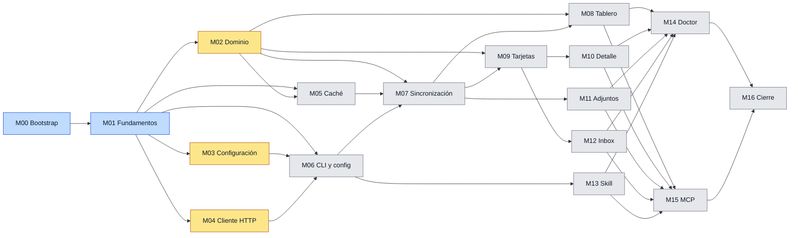

# trelloctl — Plan maestro de implementación

Este documento coordina y monitoriza la implementación del [[PRD]] v1.0.0 en 17 milestones (M00 a M16). Cada milestone tiene su propio plan en esta carpeta y está pensado para ejecutarse en un subagente aislado, en su propia rama y worktree. El PRD está cerrado y no se modifica; las interpretaciones necesarias para implementarlo están en [[#Aclaraciones de comportamiento]]. Este plan no contiene código: describe qué se construye, en qué orden, con qué pruebas y cómo se da por terminado.

Documentos relacionados: [[01-estrategia-de-pruebas]] · [[tc-manuales-trello]] · `CLAUDE.md` en la raíz del repositorio.

## Tablero de control

| Indicador                         | Valor   |
| --------------------------------- | ------- |
| Estado global                     | 🟡       |
| Ola en curso                      | 2       |
| Milestones completados            | 0 / 17  |
| TCs automatizados implementados   | 32 / 451 |
| TCs manuales ejecutados           | 0 / 11  |
| Último milestone fusionado        | M01 (local, sin PR) |

### Leyenda de semáforos

| Semáforo | Estado        | Valor en el frontmatter | Significado                                              |
| -------- | ------------- | ----------------------- | -------------------------------------------------------- |
| ⚪        | Pendiente     | `pending`               | No ha empezado                                           |
| 🟡        | En curso      | `in_progress`           | Un subagente trabaja en él                               |
| 🔵        | En revisión   | `in_review`             | PR abierto contra `develop`, esperando CI y revisión     |
| 🟢        | Completado    | `done`                  | Fusionado en `develop` con CI verde                      |
| 🔴        | Bloqueado     | `blocked`               | Detenido; el motivo está en la bitácora del milestone    |

El estado global es 🔴 si hay algún milestone bloqueado, 🟢 si los 17 están completados, 🟡 si alguno está en curso o en revisión y ⚪ en otro caso.

## Milestones

Fases de cada milestone: **F1** implementación · **F2** pruebas unitarias · **F3** TCs automatizados · **F4** verificación local · **F5** PR, CI y merge. TCs: positivos / negativos / borde.

| Milestone                          | Ola | Depende de                  | F1 | F2 | F3 | F4 | F5 | Estado | TCs (P/N/B)     | PR |
| ---------------------------------- | --- | --------------------------- | -- | -- | -- | -- | -- | ------ | --------------- | -- |
| [[M00-bootstrap\|M00 Bootstrap y arnés de pruebas]]       | 0 | —                       | 🟢 | 🟢 | 🟢 | 🟢 | ⚪ | 🔵 | 13 (6/5/2) | — |
| [[M01-fundamentos\|M01 Fundamentos]]                       | 1 | M00                     | 🟢 | 🟢 | 🟢 | 🟢 | ⚪ | 🔵 | 19 (12/4/3) | — |
| [[M02-dominio\|M02 Dominio]]                               | 2 | M01                     | 🟡 | ⚪ | ⚪ | ⚪ | ⚪ | 🟡 | 22 (9/4/9) | — |
| [[M03-configuracion\|M03 Configuración]]                   | 2 | M01                     | 🟡 | ⚪ | ⚪ | ⚪ | ⚪ | 🟡 | 21 (10/6/5) | — |
| [[M04-cliente-http\|M04 Cliente HTTP]]                     | 2 | M01                     | 🟡 | ⚪ | ⚪ | ⚪ | ⚪ | 🟡 | 21 (7/12/2) | — |
| [[M05-cache\|M05 Caché SQLite]]                            | 3 | M01, M02                | ⚪ | ⚪ | ⚪ | ⚪ | ⚪ | ⚪ | 17 (12/2/3) | — |
| [[M06-cli\|M06 Registro, CLI y config]]                    | 3 | M01, M03, M04           | ⚪ | ⚪ | ⚪ | ⚪ | ⚪ | ⚪ | 33 (21/11/1) | — |
| [[M07-sincronizacion\|M07 Sincronización y resolución]]   | 4 | M02, M05, M06           | ⚪ | ⚪ | ⚪ | ⚪ | ⚪ | ⚪ | 51 (25/15/11) | — |
| [[M13-skills\|M13 Skill]]                                  | 4 | M06                     | ⚪ | ⚪ | ⚪ | ⚪ | ⚪ | ⚪ | 15 (12/3/0) | — |
| [[M08-tablero\|M08 Tablero]]                               | 5 | M02, M07                | ⚪ | ⚪ | ⚪ | ⚪ | ⚪ | ⚪ | 41 (24/12/5) | — |
| [[M09-tarjetas\|M09 Tarjetas]]                             | 5 | M02, M07                | ⚪ | ⚪ | ⚪ | ⚪ | ⚪ | ⚪ | 61 (33/18/10) | — |
| [[M11-adjuntos\|M11 Adjuntos]]                             | 5 | M07                     | ⚪ | ⚪ | ⚪ | ⚪ | ⚪ | ⚪ | 21 (10/8/3) | — |
| [[M10-detalle-tarjeta\|M10 Detalle de tarjeta]]            | 6 | M09                     | ⚪ | ⚪ | ⚪ | ⚪ | ⚪ | ⚪ | 39 (24/13/2) | — |
| [[M12-inbox\|M12 Inbox]]                                   | 6 | M09                     | ⚪ | ⚪ | ⚪ | ⚪ | ⚪ | ⚪ | 19 (11/7/1) | — |
| [[M14-doctor\|M14 Doctor]]                                 | 7 | M08, M10, M11, M12, M13 | ⚪ | ⚪ | ⚪ | ⚪ | ⚪ | ⚪ | 25 (13/10/2) | — |
| [[M15-mcp\|M15 Servidor MCP]]                              | 7 | M08, M10, M11, M12, M13 | ⚪ | ⚪ | ⚪ | ⚪ | ⚪ | ⚪ | 19 (12/6/1) | — |
| [[M16-cierre\|M16 Cierre]]                                 | 8 | M14, M15                | ⚪ | ⚪ | ⚪ | ⚪ | ⚪ | ⚪ | 14 (14/0/0) | — |
| **Total**                                                  |   |                         |    |    |    |    |    |    | **451 (255/136/60)** | |

## Olas de ejecución

Una ola agrupa milestones sin dependencias entre sí; sus subagentes trabajan en paralelo. Una ola empieza cuando todas las dependencias de sus milestones están en 🟢; no hace falta esperar a que termine la ola anterior completa.

| Ola | Milestones         | Subagentes en paralelo | Estado |
| --- | ------------------ | ---------------------- | ------ |
| 0   | M00                | 1                      | 🔵      |
| 1   | M01                | 1                      | 🔵      |
| 2   | M02, M03, M04      | 3                      | 🟡      |
| 3   | M05, M06           | 2                      | ⚪      |
| 4   | M07, M13           | 2                      | ⚪      |
| 5   | M08, M09, M11      | 3                      | ⚪      |
| 6   | M10, M12           | 2                      | ⚪      |
| 7   | M14, M15           | 2                      | ⚪      |
| 8   | M16                | 1                      | ⚪      |

## Grafo de dependencias

El color de cada nodo es su semáforo: gris pendiente, amarillo en curso, azul en revisión, verde completado, rojo bloqueado. Al cambiar el estado de un milestone se cambia su clase en la última línea del grafo.

## Cobertura del PRD por milestone

| Requisitos                       | Milestone principal | Refuerzo en      |
| -------------------------------- | ------------------- | ---------------- |
| RF-1 Configuración               | M03, M06            | M07, M16         |
| RF-2 Directorio de trabajo       | M01                 | M06, M08, M11    |
| RF-3 Salida JSON                 | M01, M06            | M15, M16         |
| RF-4 Ayuda, RF-6 Versión         | M06                 | M16              |
| RF-5 Doctor                      | M14                 | —                |
| RF-7 Resolución                  | M02, M07            | M09, M10         |
| RF-8 a RF-11 Tablero             | M08                 | M02              |
| RF-12 a RF-16 Tarjetas           | M09                 | M02              |
| RF-17 a RF-20 Detalle            | M10                 | —                |
| RF-21 Adjuntos                   | M11                 | M04              |
| RF-22 Caché                      | M05, M07            | M08, M09         |
| RF-23 Robustez frente al API     | M04                 | M07              |
| RF-24 Logs                       | M01, M06            | M04              |
| RF-25 MCP                        | M15                 | —                |
| RF-26 Skill                      | M13                 | M16              |
| RF-27 Multiplataforma            | M01                 | M16 y CI         |
| RF-28 Inbox                      | M12                 | M13, M14         |
| RNF-1 a RNF-10                   | M16                 | M01, M04, M06    |

El comprobador de trazabilidad verifica en cada ejecución de CI que todo AC y RNF del PRD tiene al menos un TC en algún milestone o, en el caso de RNF-2 (A-18), en los TCs manuales ([[01-estrategia-de-pruebas#Trazabilidad]]).

## Aclaraciones de comportamiento

Puntos que el PRD no fija o que necesitan una regla única para escribir los TCs. Los TCs que dependen de una aclaración la citan en su columna AC (por ejemplo, `A-13`). No modifican el PRD; son vinculantes para la implementación. Todas las fijó el responsable el 2026-11-09 mediante revisión con human in the loop.

| Id   | Estado    | Tema                                   | Regla                                                                                                                                                                                                                      | Base en el PRD        |
| ---- | --------- | -------------------------------------- | -------------------------------------------------------------------------------------------------------------------------------------------------------------------------------------------------------------------------- | --------------------- |
| A-1  | decidida  | `mcp serve` sin el extra               | `USAGE`, salida 2, mensaje en inglés con el comando para instalar `trelloctl[mcp]`.                                                                                                                                         | AC-25.4               |
| A-2  | decidida  | `doctor --json` con algún `FAIL`       | `ok: true`, el informe completo en `data`, salida 1.                                                                                                                                                                        | AC-5.1, AC-5.4        |
| A-3  | decidida  | `--pos <índice>` fuera de rango        | Rango válido 0..N, con N el número de elementos del destino (N equivale a `bottom`). Fuera de rango, negativo o no numérico: `USAGE` sin ninguna escritura (el recuento sale del caché o, si venció, de su recarga). Cabeza y cola ya existen como `top` y `bottom`; no se añaden alias porque el PRD está cerrado. | AC-9.1, AC-12.2, §12-8 |
| A-4  | decidida  | Comandos sin `config.toml`             | `cache status`, `cache clear` y `card attachments clear` no exigen `config.toml` porque no llaman al API.                                                                                                                  | AC-1.2                |
| A-5  | decidida  | Valores desconocidos en listas de opción | `--fields` o `--in` con un campo desconocido, y un patrón que queda vacío al quitar comodines cuando `--in` incluye `comments`: `USAGE` sin llamar al API.                                                                 | AC-10.1, AC-11.3, AC-13.3 |
| A-6  | decidida  | Destino existente sin `--force`        | `config init` y `skills install` sobre un archivo existente: `USAGE`, salida 2, sin modificar nada.                                                                                                                        | AC-1.3, AC-26.2       |
| A-7  | decidida  | Orden de validación                    | Argumentos (`USAGE`) → HOME (`HOME_NOT_WRITABLE`) → `config.toml` (`CONFIG_NOT_FOUND`, `CONFIG_INVALID`) → credenciales (`AUTH_MISSING`) → tablero (`BOARD_NOT_CONFIGURED`) → llamada al API.                             | AC-1.2, AC-1.5, AC-1.8 |
| A-8  | decidida  | Frontera del TTL                       | Un dato vence cuando su edad es mayor o igual que su TTL.                                                                                                                                                                  | AC-22.3               |
| A-9  | decidida  | Nombres de adjuntos en disco           | Se reemplazan por `_` los separadores, `..` y los caracteres reservados en Windows, manteniendo el patrón `<attachment_id>_<nombre>`; el archivo queda siempre dentro de `attachments/<board_id>/<card_id>/`.                                                                                    | AC-21.2, AC-2.2       |
| A-10 | decidida  | Recarga fallida sin datos en caché     | Se devuelve el error original; `CACHE_STALE` solo aplica cuando hay datos que servir.                                                                                                                                      | AC-22.10              |
| A-11 | decidida  | Archivo de entrada inexistente         | `--desc-file`, `--text-file`, `--items-file` o `--file` inexistente o ilegible: `USAGE`.                                                                                                                                   | AC-12.4, AC-21.5      |
| A-12 | decidida  | Comprobaciones de `doctor` no aplicables | Sin tablero por defecto: `WARN`. Extra MCP ausente: `OK` con "not installed (optional)". Skill no instalado o con versión distinta: `WARN`.                                                                             | AC-5.2                |
| A-13 | decidida  | Texto enriquecido en descripción y comentarios | El texto de `--desc`, `--desc-file`, `--desc -`, `--text`, `--text-file` y `--text -` se envía a Trello tal cual, sin conversión ni validación: Trello lo almacena e interpreta como Markdown (negritas, listas, enlaces, encabezados, código) y las menciones `@username`. HTML no se convierte ni se escapa. Aplica a `card create`, `card update`, `inbox add`, `card comment add` y `card comment edit`. `card get` y `card comments` devuelven el Markdown original. | AC-12.3, AC-12.4, AC-17.2, AC-17.3, AC-28.3 |
| A-14 | decidida | Valores de 8 caracteres alfanuméricos | Para tableros y tarjetas, un valor de 8 caracteres alfanuméricos se busca primero por nombre y, si no hay coincidencia, por shortLink, contra el caché (`member_boards` o `cards`) y sin llamadas extra; la recarga y el reintento de AC-22.12 aplican a ambos. Ids de 24 hexadecimales, URLs e `idShort` no cambian. Prevalece sobre el orden de AC-1.9 y AC-7.3 (ver [[#Notas para versiones futuras]]). | AC-1.9, AC-7.3 |
| A-15 | decidida | Tarjetas sin tablero seleccionado | Los comandos `card` con una tarjeta dada por id o URL la localizan sin tablero seleccionado (`GET /cards/{id}` o `GET /cards/{shortLink}` de la URL); el contexto (listas, etiquetas, miembros y caché) es el tablero de la tarjeta, incluido el Inbox. shortLink suelto, `idShort` y nombre exigen tablero seleccionado (`BOARD_NOT_CONFIGURED`), porque se buscan en su caché (A-14). La localización vive en `app/resolver.py` (M07) y la reutilizan todos los comandos `card`. | AC-28.7, AC-22.9, AC-1.8 |
| A-16 | decidida | `config validate` y claves desconocidas | Con problemas, `config validate` devuelve `CONFIG_INVALID`, salida 3, con `details.problems` (clave TOML y motivo), incluido `board.default` inaccesible. Una clave TOML desconocida se ignora y solo genera un aviso en `meta.warnings`; ningún comando falla por ella, tampoco `config validate`. | AC-1.6, AC-1.7 |
| A-17 | decidida | Tarjetas de una lista desaparecida | Al recargar metadatos, las tarjetas cuya lista ya no existe se eliminan del caché. Si un comando las necesita después, se piden al API a demanda (`GET /cards/{id}`) y vuelven al caché con su lista real. | AC-22.14 |
| A-18 | decidida | Verificación de RNF-2 | El arranque en frío se mide a mano en la máquina del responsable (TC-MAN-11); no hay medición automatizada en CI. | RNF-2 |
| A-19 | decidida | Destino de las comprobaciones de red de `doctor` | DNS y TLS se comprueban contra el host de `http.base_url` (por defecto `api.trello.com`); en las pruebas automatizadas apunta al Trello falso. `base_url` sigue siendo configurable. Si `base_url` no es HTTPS, la comprobación TLS es `WARN` «not applicable». El mensaje de fallo TLS incluye siempre la sugerencia de certificados para macOS, sin ramificar por plataforma. | AC-5.2, AC-23.6, RNF-8 |
| A-20 | decidida | Corchetes en patrones de búsqueda | En la búsqueda local (`name`, `desc`, `checklists`) el patrón se evalúa con GLOB, incluidas las clases `[...]`. En `comments` se eliminan `*`, `?`, `[` y `]` antes de llamar a `GET /search` y `meta.warnings` indica que el API no los admite. | AC-13.3 |
| A-21 | decidida | Índices en movimientos | `--to-index N` y `--pos N` indican la posición final del elemento tras moverlo; dentro de la misma lista el rango válido es 0..N-1. `--to-index` negativo es `USAGE`. `--left`/`--right` sobre una tarjeta de una lista archivada devuelve `MOVE_OUT_OF_RANGE` con `from_index` nulo, sin escrituras. | AC-9.4, AC-14.1, AC-14.2, AC-14.3 |
| A-22 | decidida | Reglas menores (la opción más simple) | Credencial vacía (`""`) equivale a ausente. Un valor numérico inválido o negativo en `config.toml` es `CONFIG_INVALID`. `config board set` sin sección `[board]` la añade al final. Un 429 sin cabeceras `x-rate-limit-*` deja nulos los campos de detalle. En `label`/`member add\|remove\|set` se resuelven todos los valores antes de escribir; si uno no existe, `<ENTIDAD>_NOT_FOUND` y no se escribe nada. `--items-file` ignora líneas vacías y finales de línea. `--clamp` con el elemento ya en el extremo no escribe y devuelve origen igual a destino. Si la lectura de confirmación de AC-22.13 encuentra la entidad, se devuelve el error original de la escritura sin reintentar. | AC-1.5, AC-1.6, AC-1.10, AC-23.2, AC-18.1, AC-19.1, AC-20.2, AC-14.3 |
| A-23 | decidida | Contenido que escribe `config init` | `config init` escribe la configuración mínima de §10.5 con solo `[auth]` activo (`api_key` y `token` vacíos, con las URLs para obtenerlos). Todas las demás secciones y claves de la plantilla completa de §10.5 van a continuación comentadas, cada una con su valor por defecto y su explicación, en inglés (RNF-10). Como una clave ausente toma su valor por defecto, la configuración efectiva es la misma que con la plantilla completa. `config board set` añade una sección `[board]` activa al final y conserva el bloque comentado. Prevalece sobre la presentación de la plantilla en §10.5. | AC-1.3, AC-1.12, AC-1.10, AC-28.6 |
| A-24 | decidida | Tableros archivados en la resolución por nombre | Por defecto, la resolución por nombre de `--board`, `TRELLO_BOARD` y `config board set` solo considera tableros activos (no archivados en Trello, `closed = false`), estén o no en `config.toml`. La opción global `--include-archived-boards` (en MCP, el parámetro opcional `include_archived_boards` junto a `board`) incluye también los archivados; con ella, un nombre repetido entre un tablero activo y uno archivado da `AMBIGUOUS_BOARD`. Por id, shortLink o URL un tablero archivado se alcanza siempre. Amplía el contrato de la CLI de §10.5. | AC-1.9, AC-7.1, AC-25.1 |
| A-25 | decidida | `mcp serve` sin configuración y entrada estándar | `mcp serve` arranca aunque falten `config.toml` o credenciales; cada `tools/call` devuelve el envelope de error correspondiente (`CONFIG_NOT_FOUND`, `AUTH_MISSING`) con `isError: true`. En MCP, el valor `-` (stdin) de `desc`, `text` y similares devuelve `USAGE` («stdin not available in MCP»), porque stdin es el canal del protocolo. | AC-25.2, AC-25.3, AC-1.2, AC-12.4 |

## Notas para versiones futuras

Observaciones del responsable que no cambian el PRD v1.0.0 y se tendrán en cuenta en la próxima versión:

- **shortLink.** Candidato a deprecarse como forma de identificar tableros y tarjetas: un harness usa ids y una persona usa nombres. Mientras siga en el PRD, A-14 da prioridad al nombre.
- **Caché de tableros desaparecidos.** Si un tablero se borra o se pierde el acceso, `BOARD_NOT_FOUND` es correcto, pero sus filas quedan en `cache.db` hasta un `cache clear`: no se sirven nunca y `cache status` las sigue mostrando. El PRD no lo define y el plan lo deja así; decidir en la próxima versión si se purgan al confirmar `BOARD_NOT_FOUND`.

### Conciliación pendiente con el PRD

Aclaraciones que prevalecen sobre la letra del PRD v1.0.0 o la amplían. En la próxima versión del PRD hay que incorporarlas al texto indicado para que PRD y plan vuelvan a coincidir.

| Aclaración | Texto del PRD afectado | Qué hay que conciliar |
| ---------- | ---------------------- | --------------------- |
| A-23 | AC-1.3 y §10.5 («Plantilla completa, la que escribe `config init`») | `config init` escribe la configuración mínima (solo `[auth]` activo) y el resto de la plantilla comentado con sus valores por defecto; §10.5 debe mostrar ese archivo como el que genera `config init` |
| A-14 | AC-1.9, AC-7.3 (orden id, shortLink, URL, nombre) y §10.6 (`member_boards` solo se consulta con nombres) | Un valor de 8 alfanuméricos se busca primero por nombre y luego por shortLink; posible deprecación del shortLink (nota anterior) |
| A-15 | AC-1.8 («sin ninguno de los tres, `BOARD_NOT_CONFIGURED`») | Los comandos `card` con una tarjeta dada por id o URL no exigen tablero seleccionado |
| A-17 | AC-22.14 («se marcan rancias») | Las tarjetas de una lista desaparecida se eliminan del caché y se piden a demanda |
| A-19 | AC-5.2 («DNS y TLS con `api.trello.com`») | Las comprobaciones apuntan al host de `http.base_url` |
| A-20 | AC-13.3 (solo `*` y `?` como comodines) | La búsqueda local admite también clases `[...]`; en comentarios se eliminan con aviso |
| A-24 | §10.5 (opciones globales), AC-1.9, AC-25.1 | Nueva opción global `--include-archived-boards` y parámetro MCP `include_archived_boards`; por defecto, la resolución por nombre excluye los tableros archivados en Trello |
| — | RF-22 y §10.6 | Purga, o no, del caché de un tablero borrado o inaccesible (ver la nota anterior) |

## Protocolo de ejecución

### Prerrequisitos

- `git`, `uv` y Python ≥ 3.12 en la máquina del orquestador.
- `gh` instalado y autenticado con permiso de escritura en `dayler/trelloctl` (abrir y fusionar PRs, leer el estado de CI).
- `develop` actualizado y con CI verde antes de lanzar cada ola.

### Orquestador (sesión principal)

1. Elige los milestones listos: todas sus dependencias en 🟢 en la tabla de [[#Milestones]].
2. Marca cada uno en 🟡 (estado y F1) en este plan y en el grafo, y registra el inicio en la [[#Bitácora del plan]]. Este commit va directo a `develop` con tipo `docs(plan)` y solo toca este archivo y los campos de estado (frontmatter y tabla de fases) del milestone afectado; es la única excepción a trabajar por PR.
3. Lanza un subagente por milestone, en worktree aislado, con la [[#Plantilla de encargo al subagente]].
4. Al recibir el informe: comprueba que el PR existe, que CI está en verde en los 3 sistemas operativos y las 3 versiones de Python, y que el diff respeta el alcance y la lista **No toca** del milestone.
5. Fusiona el PR con merge commit (equivalente a `--no-ff`) y borra la rama.
6. Actualiza en un commit `docs(plan)` directo a `develop`: la fila del milestone (fases, estado 🟢, PR), el tablero de control, el estado de la ola, la clase del nodo en el grafo, F5 y `status: done` en el archivo del milestone, y la bitácora.
7. Si un subagente informa de un bloqueo, marca 🔴 en este plan con el motivo y decide: corregir la dependencia en un PR aparte, replanificar o consultar al responsable.
8. Tras fusionar M16, el responsable ejecuta los TCs manuales de [[tc-manuales-trello]] y registra el resultado; es condición para fusionar `develop` en `main`.

### Subagente (un milestone)

1. Lee `CLAUDE.md`, el archivo de su milestone completo, las secciones del PRD de su **Lectura obligatoria**, las aclaraciones citadas y [[01-estrategia-de-pruebas]].
2. Crea `feature/mNN-<slug>` desde `develop` actualizado.
3. Pone `status: in_progress` y F1 en 🟡 en su archivo de milestone; al terminar cada fase la pasa a 🟢 y la siguiente a 🟡, con un commit por fase como mínimo.
4. Implementa el alcance, escribe las pruebas unitarias y automatiza cada TC de su tabla con el marcador `tc` y el id del TC.
5. Ejecuta la verificación local de `CLAUDE.md` (lint, formato, tipos, suite completa con cobertura, trazabilidad).
6. Abre el PR contra `develop` con título `Mxx: <título>`, F5 en 🔵 y `status: in_review`. El cuerpo del PR lista los TCs automatizados, la cobertura obtenida y cualquier desviación.
7. No modifica el PRD, este plan maestro ni los archivos de otros milestones, ni los archivos de su lista **No toca**. Si los necesita, pone 🔴 en su milestone, anota el motivo en su bitácora y se detiene informando al orquestador.
8. Termina con un informe: enlace al PR, TCs automatizados, cobertura, desviaciones y riesgos.

### Plantilla de encargo al subagente

> Ejecuta el milestone `docs/plan/<archivo del milestone>` del repositorio trelloctl. Sigue `CLAUDE.md` y el protocolo de subagente de `docs/plan/00-plan-maestro.md`. Trabaja solo en la rama `<rama del milestone>`, creada desde `develop`. Respeta el alcance y la lista **No toca**. Automatiza todos los TCs de la tabla del milestone con el marcador `tc`. Mantén los semáforos de tu archivo de milestone al día. Abre el PR contra `develop` cuando la verificación local esté en verde. Si te bloqueas, marca 🔴, explica el motivo en la bitácora del milestone y detente. Devuelve el enlace al PR, los TCs automatizados, la cobertura y las desviaciones.

### Propiedad de archivos en paralelo

- Cada milestone declara qué archivos crea, cuáles modifica y cuáles no toca. Dos milestones que se ejecutan a la vez nunca modifican el mismo archivo, salvo `registry.py`, cada uno en su bloque. Un milestone puede ampliar un archivo de otro ya fusionado si lo declara en **Modifica**.
- `registry.py` se organiza en bloques delimitados por grupo de comandos desde M06; cada milestone solo edita su bloque, de modo que los merges no colisionan.
- El Trello falso se organiza en un módulo por recurso; el núcleo descubre los módulos automáticamente, así que añadir uno no edita ningún archivo común.
- Las pruebas de aceptación van en archivos `test_mNN_*` propios de cada milestone.
- `infra/` y `domain/` se cierran tras la ola 4: los milestones de las olas 5 a 8 no los modifican. Si hace falta un cambio, el orquestador lo hace en un PR previo y pequeño.

## Definición de terminado común

- El alcance del milestone está implementado y no se tocó ningún archivo de su lista **No toca**.
- Cada TC de su tabla tiene al menos una prueba automatizada marcada con su id y pasa.
- Cada módulo nuevo o modificado tiene pruebas unitarias.
- La suite completa alcanza al menos un 90 % de cobertura de líneas y ramas en cada sistema operativo y versión de Python de la matriz.
- Lint, formato y tipado estricto sin errores.
- El comprobador de trazabilidad pasa.
- Ninguna prueba sale a Internet ni usa credenciales reales.
- Todo texto que la herramienta emite o instala está en inglés (RNF-10); `docs/` y `README.md` están en español (el README queda fuera de la comprobación de idioma).
- Ningún commit, PR, comentario de código ni documento atribuye la autoría a herramientas o modelos de IA.
- PR contra `develop` con CI verde en Windows, Linux y macOS con Python 3.12, 3.13 y 3.14, fusionado con merge commit.
- Semáforos y bitácora del milestone al día.

## Integración continua

El workflow `.github/workflows/ci.yml` corre en cada PR contra `develop` o `main`, en cada push a esas ramas y bajo demanda. Su diseño para el plan gratuito de GitHub Actions está en [[01-estrategia-de-pruebas#Integración continua]]. Mientras no exista `pyproject.toml` solo corre el job `detect` y el resto se omite, así que el workflow queda en verde con el repositorio de solo documentación; M00 lo activa al añadir el paquete.

## Bitácora del plan

| Fecha      | Evento                                                                 |
| ---------- | ---------------------------------------------------------------------- |
| 2026-11-09 | Plan creado a partir del PRD v1.0.0; 17 milestones, 420 TCs automatizados |
| 2026-11-09 | Aclaraciones A-5 a A-12 aprobadas por el responsable sin cambios; todas las aclaraciones quedan decididas |
| 2026-11-09 | Aclaración A-13 (Markdown en descripción y comentarios) aprobada por el responsable (+3 TCs, total 423) |
| 2026-11-09 | Revisión independiente del plan: aclaraciones A-14 a A-22 decididas por el responsable; corregidas dependencias, propiedad de archivos, niveles de TC y huecos de cobertura; M15 pasa a depender de M13; RNF-2 pasa a verificación manual (TC-MAN-11) |
| 2026-11-09 | Aclaración A-23 (`config init` escribe la configuración mínima y el resto comentado) decidida por el responsable (+1 TC) |
| 2026-11-09 | Aclaración A-24 (`--include-archived-boards`) decidida por el responsable; caché de tableros desaparecidos anotado para conciliación con el PRD (+6 TCs) |
| 2026-11-09 | Segunda revisión independiente: A-25 y ampliaciones de A-15, A-19 y A-22 resueltas con la opción más sencilla; inventario de endpoints movido a M14; localización de tarjetas sin tablero en M07; TCs ajustados (+5 netos) |
| 2026-11-09 | El responsable decide que `README.md` va en español (única excepción fuera de `docs/`) y queda excluido de la comprobación RNF-10; ajustados `CLAUDE.md`, M15 y M16 |
| 2026-11-09 | M00 verificado y fusionado en `develop` en local (sin PR ni CI): 13 TCs, cobertura 100 %, seis controles en verde; M01 en curso |
| 2026-11-09 | M01 verificado y fusionado en `develop` en local (sin PR ni CI): 19 TCs, cobertura 99,6 %; ola 2 (M02, M03, M04) en curso |
